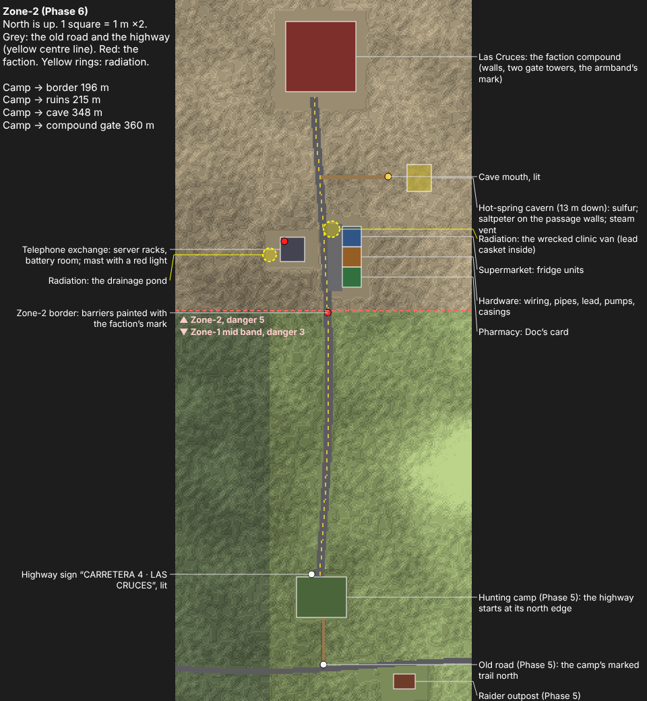

# Phase 6 — Zone-2 and power (M3)

The aim: the scout's map scrap pays off. An old highway runs north from the hunting camp to **Las Cruces**, the name pencilled on the scrap: the walled compound of the faction whose armband the scout wore. On the way stand the **commercial ruins**, a strip mall and a telephone exchange, full of what the valley needs to go electric: roof panels, wiring, battery cells, server racks, fridge and pump units, pipes and lead. Under a low bank a **hot-spring cave** gives saltpeter and sulfur for gunpowder. Two small, clearly marked **radiation hotspots** are the first radiation in the game, and **Doc**, a new voice on the phone, treats it.

Bringing the salvage home and wiring it up completes **M3, power up**: a solar array and a battery bank, the first Bitcoin mining rig, a fridge and a water pump, ammunition you make yourself, and Marco selling guns.

Each step is committed with its tests and marked DONE here.

## What the owner taught us

Simple, short, well lit, easy to find. So in this phase:
- Every place is on the highway or at the end of a short, lit trail off it, with a landmark you can see from the road.
- The faction keeps its highway lit: a lamp post every 32 m, all the way from the camp to the gate.
- A toast says what can be done there, the first time.
- Nothing is hidden or made to look like everything round it. Salvage looks like what it is: panels on the roofs, racks in a server room, fridges in a supermarket.

## The map

`docs/phase6-map.png`, drawn from the layout itself by `tools/zone2map.ts`. North is up.

**How a first-time player finds each place:**
1. **The highway.** At the old road, the camp's marker (Phase 5) now carries a second board under it: "LAS CRUCES ↑". Up the camp's trail, at the clearing's north edge between the lodge and the shed, a big green highway sign, lit, reads "CARRETERA 4 · LAS CRUCES". The asphalt starts there, six wide with a yellow centre line, and runs north. The lamp posts lead the way.
2. **The border** (196 m up). A chicane of concrete barriers across the highway, painted with the same broken white circle as the scout's armband, two faction flags. The first time: a toast names Zone-2 and danger 5.
3. **The ruins** (215 m). Right after the border. On the right (east), a long low strip mall behind a parking lot, three shop signs in a row: FARMACIA, FERRETERÍA, SUPERMERCADO, with solar panels glinting on its roof. On the left (west), the telephone exchange: a grey block with a lattice mast and a **red light on top**, seen from the camp's sign. Both are lit.
4. **The hot-spring cave** (300 m, then 50 m east). A **steam plume** rises from the ground east of the highway, seen from the ruins. A lit trail runs east to a timber-framed mouth in a low bank, with a lantern either side.
5. **Las Cruces** (360 m). The highway ends at its gate. From the ruins you look straight up the road at grey walls, two towers with searchlights, and the broken circle painted big over the gate.

| From the camp's clearing | Distance |
|---|---|
| The border | 196 m |
| The ruins (pharmacy end) | 215 m |
| The cave trail, then the mouth | 297 m, then 50 m east |
| The compound's gate | 360 m |

**Why the border moved south:** Zone-2 used to begin at z 650, which put the ruins 350 m up the highway. Faction territory now begins at z 760 west of the saddle (`ZONES.zone2Play`), so the walk from the camp to the ruins is under a minute. The land itself is unchanged: the generator still shapes the ground with the old line. North of the buffer and in the canyon, nothing changes.

## 1. Places (layout: `src/gen/layout.ts`, `ZONE2`; blocks: `src/gen/zone2.ts`)

| Place | Where | What is there |
|---|---|---|
| **The highway** | x ≈ 797–804, from the camp (z 958) north to the gate (z 602) | Old asphalt, six wide, a dashed yellow centre line, guard-rail stubs, kilometre posts. Lamp posts every 32 m. |
| **The border** | z 762 | Concrete barriers in a chicane, the faction's mark painted on them, two flags. |
| **The strip mall** | east side, x 814–828, z 698–743 | Three shops, fronts to the highway, a parapet roof with **salvageable solar panels**. Lit: a lamp over each door. |
| — Farmacia | z 728–743 | A counter with **Doc's card** (right-click), shelves (a chest: bandages, a first-aid kit). |
| — Ferretería | z 713–728 | **Cable trays** (wiring), **copper pipes** (pipe fittings), **old car batteries** (scrap lead), and a stock crate: a **pump unit**, wiring, fittings, and a reloading shelf (**brass casings** and **primers**). |
| — Supermercado | z 698–713 | Rows of dead **display fridges** along the back wall (each mines to a fridge unit), empty shelves. |
| **The parking lot** | x 803–814 | Painted bays, two wrecked cars, a light pole with a lamp. At its north end, a **wrecked clinic van** on its side: radiation hotspot 1. |
| **The telephone exchange** | west side, x 768–786, z 706–724 | Two rooms. The **server room**: six racks (containers holding GPUs, power supplies and mining boards). The **battery room**: three UPS cabinets (battery cells). Cable trays on the walls, panels on the roof, the lattice mast with its red light. |
| **The drainage pond** | behind the exchange, (760, 719) | Where fallout washed off the roofs: radiation hotspot 2. Nothing to gain; it teaches you to read the signs. |
| **The hot-spring cave** | trail east at z 661 to the mouth at x 848; the cavern x 862–880, z 652–672, 13 m down | A lit, timbered decline. Its walls are crusted white with **saltpeter**. At the bottom, a cavern with a steaming pool, its rim crusted yellow with **sulfur**, and a natural vent to the sky above it (the steam plume, and daylight). The raiders mined it: their lamps and a plank walkway. A rail round the vent at the top so no one falls in. |
| **Las Cruces** | x 772–824, z 546–598; gate at the highway's end | Walls 7 high of reinforced concrete, a steel gate, two watchtowers with searchlights and a guard on each, faction flags, the broken circle painted over the gate. Behind the walls: the roofs of a warehouse, a water tower, smoke. |

**Design calls:**
- **The compound can't be taken in Phase 6.** Its walls and gate are reinforced concrete and steel that no tool of yours will mark ("Reinforced concrete. Your tools won't touch it."). *Why:* the script's Zone-2 is "a larger human-occupied area… deliberate power structure", and its patrols are "1–3, never hordes". Storming a fortress would be a horde fight, and nothing in M3 hangs on it. It is a place you see, recognise and go round. A later phase may open it.
- **Radiation is in Zone-2 only**, in two small rings, never on the highway or a trail. The buffer and Zone-1 have none, as the script says.
- **The exchange** is my addition for the server racks and battery cells: a telephone exchange is the kind of building in a small Bolivian town that had racks, a battery room and a mast. The mast's red light is the landmark.

## 2. People (`src/entity/`)

| Kind | Where | Behaviour | HP | Gives |
|---|---|---|---|---|
| **Patrol** (pistol), a pair | walks the highway between the border and the gate, there and back | Raider behaviour from Phase 5: a 130° view, 35 m; aims 1 s (a click and a raised arm), 12 damage; takes cover behind barriers and cars. | 40 | pistol rounds ×4, brass casings ×4 |
| **Patrol** (machete), alone | walks a loop round the parking lot and the exchange | Like the outpost's machete man: winds up 0.7 s, 14 damage; gives up a chase after 40 m or 10 s. | 45 | scrap metal, cordage |
| **Tower guards** (rifle), two | one on each gate tower | Like the outpost's lookout: watch the highway south (140°, 50 m); a glint and a click, 1.5 s of aim, 18 damage. Stay on their towers. | 40 | rifle rounds ×6 |

- **Never hordes:** at most three in any group, and only one group within sight of most spots.
- **They come back.** Unlike the outpost, this is the faction's home ground: a patrol or guard that is killed is replaced at the next dawn. *Why:* the script's "fortified compound… patrols" is a standing force, and M3 asks for many trips.
- **The armband pays off.** The script asks that the scout's insignia "pay off at larger scale" here. So:
  1. **You recognise them.** The broken circle is on their flags, their barriers and over their gate. The first sight of it: *"The broken circle. The same mark as the scout's armband. This is who sent him: Las Cruces."*
  2. **They take you for one of theirs.** With the armband in your pack, a patrol or guard who sees you from beyond **14 m** lets you pass. Closer than that, he looks again: *"¡Oye! ¿Y tú quién eres?"*, and 1.5 s later he knows you aren't. A shot, a blow, or the alarm ends the disguise for that visit.
  3. Without it, they shoot strangers on sight. The first time you enter Zone-2 the toast says which: *"Zone 2. Faction ground, danger 5. Their patrols shoot strangers."* plus, if you carry it, *"From a distance, the scout's armband will pass you for one of theirs. Don't let them close."*
  *Why this, and not a key to the gate:* the script keeps the faction hostile and makes the insignia an observation thread. A disguise at a distance is the smallest mechanic that rewards having kept the armband, without turning the faction into a shop.
- **Stealth and cover** work as in Phase 5: an unaware raider dies silently to a blade from behind; cover stops shots; every shot is telegraphed.
- **The sanctuary rule** holds for both new kinds: no spawn, path, target or knock into the valley or the home, at any depth, each with a test.

## 3. Radiation (`src/sim/radiation.ts`)

- **The dose** is a number from 0 to 100, saved. While you stand in a ring it climbs: up to 3 a second at the van's heart, less toward the edge.
- **What it does:** it never kills by itself. It takes away the top of your health: you can't heal past **100 − 0.6 × dose** (never below 40). At a dose of 50 your health stops at 70. *Why:* a dose that killed would make a death at home a loop. A ceiling is simple to see on the health bar and makes Doc worth a call.
- **It fades slowly:** 4 a day.
- **What you see and hear** (the visible sign the owner asked for):
  - Each ring is circled by **yellow warning signs** on posts, with the black trefoil, and black-and-yellow tape between them. The ground inside is grey and dead.
  - A **Geiger hiss and clicks** start 4 m before the ring and quicken toward its heart.
  - A **dose meter** on the HUD, under the health bar: shown whenever you are in Zone-2 or carry a dose, amber, filling as it climbs.
  - First time near a ring: *"A hiss, and clicking: radiation. Stay outside the signs."* First dose: *"Your dose is rising. It caps your health until it fades, or Doc treats it."*

## 4. Doc (`data/people.json`, the phone)

- **How you meet him:** his card is on the pharmacy's counter. Right-click it: *"A card: 'Dr. Ibáñez — médico. Sat-phone.' A number. Doc."* His contact appears on the phone at home.
- **What he sells:** services, not items, priced flat per kind (DESIGN.md A3), paid from the hot wallet. The effect applies at once; he talks you through it over the phone, with what's in the builder's kit.
  | Service | Effect | Price |
  |---|---|---|
  | Wound care | health back to its ceiling | 4 units (P_wc, the anchor) |
  | Rad treatment | dose to 0 | 12 units (3 × P_wc) |
  - A unit is the existing trade unit (25,000 sats, one bandage's worth).
  - *Infection treatment is left out:* this game has no infection, so it would cure nothing. It can come with the Ashen.
- **He stays a character:** a short line each call, never a menu-only vending screen.

## 5. Items, blocks and recipes (`data/*.json`)

**Found in the ruins and the cave**

| Item | From |
|---|---|
| `pv_panel` (salvaged solar panel) | mining the roof panels (mall, exchange) |
| `wiring` (copper wiring) | mining cable trays; the hardware crate |
| `pipe_fittings` | mining copper pipes; the hardware crate |
| `scrap_lead` | mining old car batteries; the lead casket in the van |
| `battery_cell` | the exchange's UPS cabinets |
| `gpu`, `psu`, `mining_board` | the exchange's server racks |
| `fridge_unit` | mining a display fridge |
| `pump_unit` | the hardware crate |
| `brass_casing`, `primer` | the hardware's reloading shelf; patrols |
| `saltpeter` | mining the white crust on the cave's walls |
| `sulfur` | mining the yellow crust round the hot pool |

**M3's recipes** (DESIGN.md "M3 recipes", in this game's terms). Each row gates the next in the power chain, as the script's A5 lock asks: the battery bank shows once a solar array is built; the rig, the fridge and the pump once a battery bank is built (recipe `learn` flags).

| Station | Makes | From | Notes |
|---|---|---|---|
| workbench | solar array | pv panel 4, wiring 4, planks 4, nails 8 | 1 kW in full sun |
| workbench | battery bank | battery cell 6, wiring 4, planks 2, nails 6 | 12 kWh; after a solar array |
| workbench | mining rig | GPU 2, PSU 1, mining board 1, wiring 2 | 0.5 kW; after a battery bank |
| workbench | fridge | fridge unit 1, wiring 2, planks 2, nails 4 | 0.1 kW; after a battery bank |
| workbench | water pump | pump unit 1, wiring 2, pipe fittings 2, planks 2 | 0.05 kW; after a battery bank |
| workbench | powder mill | cobble 4, planks 4, nails 6, iron ingot 2 | the script's kiln-extension |
| powder mill | gunpowder ×2 | saltpeter 2, charcoal 1, sulfur 1 | |
| forge | bullet mould | iron ingot 2, stick 1 | M2's forge is the precision step |
| forge | bullet ×8 | scrap lead 1, charcoal 1 (bullet mould kept) | |
| workbench | pistol rounds ×4 | gunpowder 1, brass casing 4, bullet 4, primer 4 | |
| workbench | rifle rounds ×4 | gunpowder 2, brass casing 4, bullet 4, primer 4 | |
| workbench | rain awning ×2 | planks 2, canvas 1 | the balcony drip |

- **The powder mill is its own block**, placed beside the kiln if you like. *Why:* upgrading the kiln in place would need a second kind of kiln and a swap; a new station is one block and the same idea.
- **Gunpowder is made at once**, not over hours. *Why:* fewer screens; the smoker already teaches timed processes.
- **Firearms are still never crafted** (ADR-019). Only rounds are.

## 6. Power (`src/sim/power.ts`)

- **What counts:** solar arrays, battery banks, rigs, fridges and pumps placed anywhere in the sanctuary. They are found by the world's own record of what the player placed, so nothing new is saved for them.
- **Each game minute:** the arrays make 1 kW each × the sun's height (0 at night, full at noon). The loads take theirs. A surplus charges the banks; a shortfall drains them. A load that can't be met stops: the rig first, then the fridge, then the pump.
- **What it adds up to:** one array runs the rig by day only. Two arrays and a bank run it day and night (about 15 kWh made against 15.6 used). A third array leaves a surplus.
- **Sleep and time away:** power is stepped through the skipped minutes, so the rig earns while you sleep.

**The mining rig and the computer** (the script: "single rig, real passive income")
- While powered, the rig earns **50,000 sats a game day** (2 units: a wound care every two days; T = 2 in the script's A4 terms), straight into the hot wallet. Slow and steady, as asked.
- The builder's computer gets a **POWER** page: arrays and their output now, the bank's charge, each load on or off, and the rig's hashrate (0.84 TH/s while running) and what it has earned today and in all.

**The fridge:** a 9-slot cold store. Powered, it turns a **water jug** into a **cold water** every game hour: thirst 50 and 3 health. *Why:* this game has no spoilage, so "preserving longer" would do nothing; a cold drink is the comfort it brings.

**The water pump:** right-click it, powered, to fill every empty jug you carry, or with nothing in hand to drink your fill. The end of walking to the creek with jugs.

## 7. Marco sells guns

- **Trust 2:** the first time you call Marco after coming home from Zone-2: *"You've been up to Las Cruces and come back. Not many do. Now I can sell you real things."*
- His catalogue then adds the M3 band: **pistol** (48 units), the **worn rifle** (80), **pistol rounds** ×8 (6) and **rifle rounds** ×10 (8). Prices are multiples of P_wc (12×, 20×, 1.5×, 2×). He still buys everything at half.

## 8. M3: power up (`src/sim/milestones.ts`)

The computer lists M3's steps with ticks under M2:

| DESIGN.md | Here: done when |
|---|---|
| (the run) | you reach the ruins in Zone-2 and come home alive |
| Expanded solar array | you have placed a solar array at home |
| Battery bank | you have placed a battery bank |
| First mining rig | your rig has earned its first sats |
| Doc contact | you have called Doc |
| Fridge + water pump | both are placed at home |
| Ammunition crafting | you have made rounds |
| Marco sells firearms | you have bought a gun or rounds from Marco |

- **When all are done:** *"M3 · power up. The valley hums now, day and night."* and a page in your notes.
- **The rain awning** (M3's balcony drip) is a recipe, not a step.

## 9. Sound (made in code)

- The **Geiger** hiss and clicks, by the dose rate.
- The **hot spring's** bubbling and steam; the cave's drip.
- The **compound's** distant generator hum and a voice now and then from the walls.
- The **rig's** fan hum, the **fridge's** compressor, the **pump's** run, heard at home.
- Patrols reuse the raiders' voices and shots.

## 10. Phase 5's outpost at night

The Phase 5 review found the outpost dim at night from 40 m: only the cookfire and two door lanterns. It gets lamp posts at the yard's four corners, a lantern on the lookout's platform, one on the stripped pickup across the road, and a lit window in the back room. A test checks the light on the outpost's front at midnight.

## 11. The play-through, in parts

The one play-through took about 45 minutes here. It is split into standalone parts that each set their own scene through `window.__hv`, each under about 25 minutes, and a small runner that runs them one after another:
- `tests/e2e/play-valley.mjs`: home, the valley, the way out (Phases 0–3);
- `tests/e2e/play-outside.mjs`: Zone-1 near, mid and deep (Phases 4–5);
- `tests/e2e/play-zone2.mjs`: Phase 6;
- `tests/e2e/run-all.mjs`: runs them in turn and sums the checks.

Phase 6's part: walk up the highway from the camp; the border toast; the armband passing a patrol at a distance, and the challenge up close; the radiation signs, the hiss, the dose meter; salvage panels, a rack and the cave's crusts; build the array, bank and rig at home and see the computer's POWER page earn; call Doc and treat the dose; make rounds; buy from Marco.

## Checks

**Unit tests**
- The highway never steps more than one block, and reaches the gate. Every place is built and lit; caves never cut under them.
- Zone-2 starts at z 760 west of the saddle; the buffer and the canyon are unchanged; the valley stays danger 0.
- Zero patrol or tower-guard spawns in the sanctuary, and none walks, aims or is knocked in.
- The armband: unseen beyond 14 m, challenged within it, and lost on a shot.
- Radiation: zero on the highway and every trail; the dose climbs in a ring and caps health; it fades; Doc clears it.
- Power: an array makes nothing at night; a bank carries the rig through the night with two arrays; the rig earns only while powered; sleep steps it.
- Each M3 recipe resolves; the chain gates (bank after array, rig after bank).
- Each M3 step ticks; Marco's guns show only at trust 2.
- The outpost is lit at night.
- Old saves load: the dose, power and new flags default.

**Screenshots** from a first-time player's eye: the highway sign at the camp; the ruins from the border; the van's warning ring; the server room; the cave's hot pool; the compound's gate from the ruins.

## Build order

1. The plan and the map (this file). Shown to the owner through the lead.
2. Without waiting on the map: the outpost's night lights, and the play-through split.
3. Items, recipes, icons, trade (data first).
4. Power, the rig and the computer's POWER page; the fridge and the pump.
5. Radiation (dose, HUD meter, hiss) and Doc.
6. Ammunition: the powder mill, gunpowder, the bullet mould, rounds.
7. M3 on the computer; Marco's trust 2 and guns.
8. Once the owner's go comes: the highway, the ruins, the cave and the compound in blocks; patrols, tower guards and the armband.
9. The Phase 6 play-through and screenshots.
10. A fresh review, with fixes and a test for each. Then message the lead.

## Progress

- **DONE: The plan and the map.**
