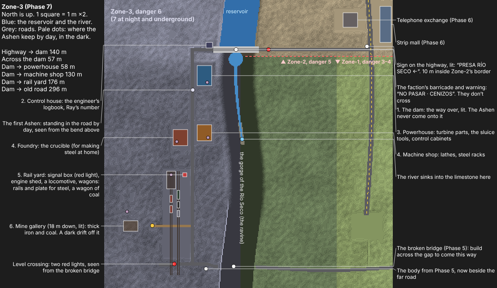

# Phase 7 — Zone-3 and hydro (M4)

The aim: the body across the ravine pays off. The ravine at the end of Zone-1's road is the gorge of a river, the **Río Seco**. Just inside Zone-2 a **dam** stands across it, and its crest is the way over. On the far bank an avenue runs south past the dam's **powerhouse**, two **machine shops** and a **rail yard** to the old road's far end at the broken bridge, where the body lies. Nobody lives here. The **Ashen** do: the script's infected, this game's first enemy that is neither a person nor an animal.

Bringing the heavy salvage home completes **M4, hydro**: steel, a lathe (workshop tier 2), a hydro generator turning in the valley's creek, a farm of mining rigs, mods for found guns, tier-2 armour, and **Ray**, the dam's old engineer, on the phone with the plans for the uplink.

Each step is committed with its tests and marked DONE here.

## What the owner taught us

Simple, short, well lit, easy to find. So in this phase:
- **One way in, one street.** Everything is on the dam road or on the avenue, in the order you walk it. Nothing is off in the trees.
- **The dam still makes power**, and nobody is left to turn the lights off. So the dam, the avenue and every doorway are lit, in a zone whose danger is the dark. *Why:* a lit way through keeps the place readable at night without making it safe: the Ashen keep to the dark between and behind the lamps.
- **Nothing you need is in the dark.** Every crate, lathe and rack stands under a working lamp or in a doorway's daylight. The dark ends of the buildings hold only the Ashen.
- **A toast** says what can be done at each place, the first time.

## The map

`docs/phase7-map.png`, drawn from the layout itself by `tools/zone3map.ts`. North is up.

**How a first-time player finds each place:**
1. **The dam road.** Ten metres past Zone-2's border barriers, on the highway's left (west), a big green sign, lit: "PRESA RÍO SECO ←". A side road, four wide and lit like the highway, runs west. The player has walked this stretch of highway already to reach the ruins.
2. **The barricade** (125 m along the dam road). Sandbags and concrete barriers across the road, the faction's flag, and a board: "NO PASAR · CENIZOS" (*cenizos*, "the ashen ones", is the faction's word). You walk round it. The first time: a toast names Zone-3, danger 6, and the Ashen.
3. **The dam** (140 m). The road runs straight onto its crest: 57 m of lit deck between parapets, the reservoir on the right, a 40 m drop and the spillway's white water on the left. **The Ashen never come onto the dam.** It is the safe place to look from, and to run back to.
4. **The control house**, at the dam's far end, its door on the road, a lamp over it. On the desk, the engineer's logbook: Ray's number.
5. **The bend**, just past it. The road turns south and drops to the plain: from here you look down the whole avenue, lamp after lamp. **The first time, by day, an Ashen stands in the road below**, 50 m off, its back to you. A toast says what it is and how to pass it.
6. **The powerhouse** (58 m from the dam), on the left, its door on the avenue. One turbine still hums.
7. **The machine shop** (left) and **the foundry** (right), 130 m, facing each other across the avenue.
8. **The rail yard** (176 m), on the right: a signal box with a red light, a locomotive, wagons.
9. **The mine** (a lit trail west across the yard, 45 m): a timbered adit, lamps all the way down.
10. **The old road** (296 m). The avenue ends at it. Left, 30 m: the body from Phase 5, and the broken bridge's far end. Right: a level crossing with two red lights, which is what you see from the bridge's near end at night.

| From the highway's sign | Distance |
|---|---|
| The barricade | 125 m |
| The dam's east end | 140 m |
| The control house (across the dam) | 197 m |

| From the dam's west end | Distance |
|---|---|
| The powerhouse | 58 m |
| The machine shop and the foundry | 130 m |
| The rail yard | 176 m |
| The old road and the body | 296 m |

**The second way in: the broken bridge.** A player who builds across the 34 m gap lands on the far abutment beside the body. The old road goes on west from there, paved again, to the crossing's red lights and the avenue's south end. The toast for Zone-3 fires on either way in.

## Design calls

- **The ravine is the river's gorge.** *Why:* PLAN.md's map puts Zone-3's "river · dam" against the ravine and has the dam reached from Zone-2. A dam across the gorge that already parts Zone-1 from Zone-3 is one landmark that does three jobs: the crossing, the river, and the source of the turbine parts.
- **The river sinks.** Below the dam the river runs 110 m down the gorge and goes underground into the limestone, as the valley's creek and the canyon's stream do. *Why:* the gorge at the broken bridge stays dry, exactly as Phase 5 built it (a stream there would also break a fall into the gorge, which must stay deadly). And it leaves a quiet answer to where the valley's hidden river comes from. Ray says it: "The Seco goes underground below my dam. Nobody ever found where it comes out."
- **The dam sits at z 752**, 10 m inside Zone-2 (which begins at z 760). *Why:* the shortest walk that is still "from Zone-2".
- **The reservoir's west shore is raised.** North of the dam the land west of the gorge now stands at about 86 instead of 76, so the water has a bank. Below the dam it falls to the old plain. East of the gorge three things change, and nothing else:
  - the dam road's corridor and the strip mall's lot (the small fix below): five columns in all. A hash of every column east of x 672 is kept in `tests/fixtures/east-of-ravine.json` and checked;
  - the reservoir's east shore, from its head (z 186) to the dam: where the gorge's rim lay under the water's level it is raised to two blocks above it, in a band 22–44 m east of the centre line (234 cells). *Why:* without a bank the water would stand as a wall beside lower ground. The rim cannot be hashed by whole columns (the gorge shares them), so it is hashed row by row in `tests/fixtures/east-rim.json`: no row north of the reservoir or south of the dam's face differs;
  - the dam's east abutment, where the dam meets the rim.
- **No fight is needed for M4.** Every thing to bring home can be reached by day by a careful player without waking an Ashen. Killing them gives nothing: they carry nothing, and you don't touch them.
- **Infection is left out.** The script lists an infection treatment among Doc's services. *Why not now:* it would be a second "your health is capped until treated" meter beside radiation's, and the Ashen are already new. It can come with Zone-4's medicine.
- **The compound is still closed.** Nothing in M4 needs it.

## 1. Places (layout: `src/gen/layout.ts`, `ZONE3`; blocks: `src/gen/zone3.ts`)

| Place | Where | What is there |
|---|---|---|
| **The dam road** | z 750–753, from the highway (x 800) west to the dam (x 663) | Cracked asphalt four wide, lamp posts every 24 m (the faction's side: lit as their highway is), the sign at the junction. |
| **The barricade** | x 675 | Sandbags and barriers in a chicane, a faction flag, the board "NO PASAR · CENIZOS", a lantern. |
| **The dam** | x 606–663, z 749–754; crest at y 83, water at y 79 | Concrete from the gorge's floor (y 42) to the crest, stepped on its downstream face. A deck four wide between parapets, a lamp every 6 m. In the middle, the spillway: water pouring 36 m into a plunge pool. |
| **The reservoir** | the gorge north of the dam, to about z 190 | Deep water, rim to rim. |
| **The river** | below the dam to z 864 | A plunge pool, a stream that thins, a dry bed of gravel where it sinks. |
| **The control house** | x 597–605, z 743–750, on the crest road | One room: the engineer's desk with **Ray's logbook** (right-click), a wall of dead gauges, a window on the reservoir. Lit. |
| **The powerhouse** | x 586–604, z 772–797 | The turbine hall. North half, lit, through the door: one turbine still running (a hum, green lamps), the **parts crate** (the turbine parts), the **tool locker** (the sluice tools), two **control cabinets** (advanced electronics: boards, a power supply, graphics cards), a seized turbine. South half, behind a wall, dark, through its own open roller door: another seized turbine. Penstock pipes come down the bank from the dam; the tailrace pours from its east wall down into the gorge. |
| **The machine shop** | x 586–604, z 846–866 | "TALLER MECÁNICO". Through the door, lit: three **lathes** (mine one for lathe parts), **steel racks** (steel stock), a stores crate. The back half is walled off and dark, behind its own roller door. |
| **The foundry** | x 556–574, z 852–872 | "FUNDICIÓN". Through the door, lit: the **crucible** (mine it: the heart of a steel furnace), the old furnace's shell, firebrick stacks. The back half is walled off and dark. |
| **The rail yard** | x 544–575, z 902–1012 | Ballast and cinders; two tracks north–south. A **locomotive**, a **hopper wagon heaped with coal** (mine it), a **flatcar of steel plate** (mine it), two **boxcars** (one with a crate of canvas, wire and hardware in its open door). **Rails** mine to steel stock. The **engine shed** over the west track's north end, open at its south end, dark at the back. The **signal box**, two storeys, a red light on its mast. Lamp posts down the platform. |
| **The mine** | trail west at z 972 to the adit at x 530; the gallery x 494–512, 18 m down | "MINA SAN ROQUE". A timbered decline lit every four blocks, a gallery whose walls are thick with **iron and coal**. Off its far end, an **unlit drift** north: nothing in it but two Ashen. |
| **The far road** | the old road, from the bridge's far abutment (x 612) west to x 538 | Asphalt again, past the body's rise, across the tracks at a **level crossing** with two red lights. Beyond it the road is gone to forest. |

**Deep rock:** under Zone-3, below y 60, coal and iron pockets come three times as often as elsewhere (`placeOre`). Natural caves there are unlit: danger 7.

## 2. The Ashen (`src/entity/ashen.ts`, `src/render/creatures.ts`, `src/audio/audio.ts`)

**What the script gives:** people changed by the pathogen eight years ago; the "turned remnants" of the people who lived and worked here; built places give them "hiding density". The body across the ravine: not shot, not torn, twisted, a wide pale stain. The tracks: two-legged, not boots, not paws. The sound: "distant, organic, but wrong". How they move, sense and fight is not in the script, so it is designed here.

**What they look like** (original, box-built):
- Taller and thinner than a man (1.95 m, narrow), the head hung to one side, the back bent, **arms too long**, hanging past the knees.
- Skin the grey-white of wood ash, darker at the hands and round the mouth; two dark pits for eyes. No blood, no wounds.
- What is left of work clothes: faded blue overalls to the waist, a strip of orange safety vest. Bare, pale feet (the tracks).
- They **shed ash**: a pale dust falls from them when they move fast, and a pale stain lies where one has stood a long time (the stain round the body; one under each nest).

**How they sense:**
- **Light decides everything.** Each Ashen is *dull* or *keen* by the light where it stands: daylight or a lamp's pool (light 7 or more) makes it dull; the dark makes it keen. Night outside the lamps, the back of a shed and anywhere underground are dark.
- **Dull** (day, open ground, under a lamp): it stands and sways, or shuffles. It sees a walking player only within **6 m, in front of it**. It hears: a sprinting player within 16 m, mining within 8 m.
- **Keen** (dark): it sees **20 m all round**, hears a walk at 8 m, mining at 10 m and a sprint at 24 m.
- **From the dark it sees poorly into light** (added after the review). Someone standing in daylight or in a lamp's pool is seen by a keen one only within 6 m. *Why:* each nest looks straight out of its open bay at the avenue 18 m away, so a walker in the road was seen at noon by something they could not see. The rule makes the script's promise hold everywhere at once: by day in the open, and at night under the lamps, a careful player is not seen from afar. Step into the dark and you are seen at 20 m.
- **Walls stop quiet sounds** (added after the review). A walk or a pick is heard only with nothing solid between; running and gunshots carry through walls. *Why:* they heard a walk and a pick through the wall that parts each building, so the lit halves were not quiet.
- **A gunshot** is heard at 70 m, by any of them: they come to **where the shot was fired**, not to you. Moving on after a shot is the defence. (The suppressed pistol of M4 is heard at 12 m.)

**How they move:**
- Dull: 2.4 m/s, a lurching walk you can out-walk (you walk at 4).
- Keen: 5.0 m/s, faster than your walk and slower than your sprint (5.6). In the dark you cannot fight your way out slowly; you run for the light.
- An Ashen chasing into a lamp's pool or out into daylight turns dull as it crosses the line. **A placed lantern is a tool**: its pool slows them.
- They give up 45 m from their nest or after 12 s without sight or sound of you, and walk back.

**How they attack:** the lunge, always telegraphed.
1. Within 3.5 m it **stops, rears back, arms thrown wide, and shrieks** (a rising, rattling cry): 0.8 s when dull, 0.6 s when keen.
2. It **lunges 3 m** in a straight line, the way it was facing when the shriek began.
3. If you stepped **back or aside**, it misses, stumbles and stands bent for 1.6 s: the moment to strike, or to leave.
4. A hit: 16 dull, 24 keen (the vest and armour reduce it as usual).
- 60 health. Blades, arrows and bullets all work; nothing is silent on them (they don't keep watch the way men do).

**How many:** nine in the whole zone, in five nests of one or two (the pale dots on the map): the dark halves of the powerhouse, the machine shop and the foundry, the engine shed, and the mine's drift. **Never more than three hunt you at once**: a fourth that notices you only watches until one of the three is down or gives up. Killed ones stay down until the next dawn, like the faction's men; others drift in.

**By day:** they stay in their dark rooms, each with a wall between it and the lit half you work in. One is out in the road the first time (the scripted first sight); after that, by day, the avenue is empty unless a shot or a sprint brings them out through their own doors. A careful player walks the avenue, works in the lit halves, and never meets one.

**By night:** they come out and wander within 14 m of their doors, which open onto the avenue's verges. The avenue itself is lit end to end, so one that steps onto it is dull while it stands there: the road is still the way through, and the dark either side of it is theirs.

**Underground** (the mine's drift, natural caves): always dark, so always keen. The lit decline and gallery make them dull if they come in.

**Sound** (made in code): a dry, rattling breath, heard within 14 m (the warning that one is near and hasn't noticed you); a short ascending rattle when one notices you; the lunge shriek; bare feet slapping when one runs. The deep band's stinger was the far-off version of the same voice.

**The rules that hold:**
- **The sanctuary:** no Ashen spawns, walks, sees, lunges or is knocked into the valley or the home, at any depth (the same `fits` and `inSanctuary` checks as every creature, each with a test).
- **Ashen ground** is Zone-3 west of the gorge. They never step onto the dam, a bridge you build, or Zone-1 and Zone-2.
- **Hold H** already refuses for ten seconds after any hurt. It now also refuses while an Ashen that is hunting you is within 30 m ("Not with one of them on you"). *Why:* an Ashen that hasn't landed a blow yet would otherwise be escaped by standing still for two seconds.

**The Phase 5 signals pay off:** the first time you stand by the body on the far road: *"The body from across the ravine. The pale stain round it is ash. One of them stood here a long time."* The Ashen's bare feet leave the same two-toed drag as the tracks on the near bank. A page goes into your notes.

## 3. Ray (`data/people.json`, the phone)

- **How you meet him:** the logbook in the control house. *"Logbook, Presa Río Seco. The last entries are one hand: 'R. Quispe, ing.' On the inside cover, a sat-phone number and: 'If the lights are still on, someone call me.'"* His contact appears on the phone at home.
- **Who he is:** the dam's engineer. He kept it running alone for two years after the Event, then left when the Ashen came up from the yards. Dry, exact, a little proud of his dam.
- **What he does** (DESIGN.md: "premium item-priced, buy-only", and one contact-taught schematic):
  1. **Sells the micro-hydro plans** (12 units). Buying them teaches the hydro generator's recipe. The plans are knowledge, not an item (the script: schematics are recipe-unlock flags), and every recipe keeps to the script's four kinds of input.
  2. **Sells parts at a premium**: steel ingots, a graphics card, a power supply, a mining board, wiring. For players who want a bigger farm than the salvage allows. He buys nothing: Marco is the only buyer.
  3. **Gives the uplink plans.** The first call after your hydro generator is turning: *"It turns? Then you can build what I never could. I'm sending you drawings: an uplink. You'll need an antenna from the ridge tower."* The item `uplink_plans` arrives, and M4's step ticks. This is the lead-in to Phase 8.
- A unit is the trade unit, as before (25,000 sats).

## 4. Items, blocks and recipes (`data/*.json`)

**Found in Zone-3**

| Item | From |
|---|---|
| `steel_stock` (rail and plate) | mining rails, the flatcar's plate, the shop's steel racks |
| `turbine_parts` (the script's "turbine parts": the runner and the generator core) | the powerhouse's parts crate |
| `sluice_tools` (the script's "river-engineering tools": a gate winch and keys) | the powerhouse's tool locker |
| `gpu`, `psu`, `mining_board` (the script's "advanced electronics") | the powerhouse's control cabinets: enough for two more rigs |
| `lathe_parts` (headstock, chuck, lead screw) | mining a lathe in the machine shop |
| `crucible` | mining the foundry's crucible |
| `coal` | mining the hopper wagon's heap; the mine |
| canvas, wire mesh, nails, pipe fittings | the boxcar's crate |

**M4's recipes.** The chain: steel needs the crucible; the lathe needs steel; the hydro generator needs steel, the turbine parts and Ray's plans; mods and armour need the lathe.

| Station | Makes | From | Notes |
|---|---|---|---|
| workbench | crucible furnace | crucible 1, cobble 8, clay 4, iron ingot 2 | advanced smelting: its own station, set by the smelter |
| crucible furnace | steel ingot ×2 | steel stock 2, coal 1 | salvage, re-melted |
| crucible furnace | steel ingot ×2 | steel stock 2, charcoal 2 | the same with your own charcoal, so steel does not wait on finding coal |
| crucible furnace | steel ingot ×1 | iron ingot 2, coal 2 | from your own iron: steel never runs out |
| workbench | lathe | lathe parts 1, steel ingot 4, wiring 2, planks 2 | workshop tier 2 |
| workbench | hydro generator | turbine parts 1, steel ingot 6, wiring 4 (sluice tools kept) | shows once Ray's plans are bought; 2 kW, day and night |
| lathe | suppressed pistol | pistol 1, steel ingot 2, pipe fittings 1 | a found gun, modified (ADR-019) |
| lathe | rebuilt rifle | the lookout's worn rifle 1, steel ingot 3, glass 1 | re-barrelled, a scope fitted |
| lathe | plate armour | armour vest 1, steel ingot 4, leather 2 | tier 2: stops half of every blow |
| lathe | steel pickaxe | steel ingot 3, stick 2 | the "precision tools": replaces the builder's when it wears out |
| workbench | planter box ×2 | planks 3, dirt 1 | M4's balcony drip: farmland you can set on stone |

- **The hydro generator** is one block. It makes power only when set **in or beside the creek's water in the valley** (within two blocks of it). Anywhere else it sits still and says why. *Why one block:* the script calls it a major engineering project; here the project is the chain that leads to it (Zone-3 run, steel, Ray's plans). A multi-block machine would add building rules and nothing to the story.
- **Gun mods consume the gun** and give the better one, so they are always "on found guns".
  - Suppressed pistol: as the pistol, but heard at 12 m instead of 60–150 m by raiders, the faction and the Ashen.
  - Rebuilt rifle: 48 damage (the worn rifle does 40), 150 m, a little faster.
- **Plate armour** lets 50% of a blow through (the vest lets 70%, leather 85%).

## 5. Power: hydro and the farm (`src/sim/power.ts`)

- **Hydro:** each generator in the creek makes **2 kW, day and night**. (An array makes 1 kW at noon and nothing at night.) One generator alone carries four rigs, the fridge and the pump around the clock with no battery.
- **The farm** (the script: the multi-rig farm "gates on hydro"). Until now every rig stopped if there wasn't power for all of them. Now **as many rigs run as there is power for**, and **rigs beyond the first run only on hydro**: without a generator, one rig is all that will run however many arrays there are. *Why:* that is the script's gate, in one rule.
- **Earnings stay slow and simple:** each running rig earns 50,000 sats a game day, as before. Four rigs: 200,000 a day (8 units).
- **The computer's power lines** add: "Hydro: 1 generator · 2.00 kW, day and night", and "Farm: 3 of 4 rigs running · 2.52 TH/s".
- Salvage gives parts for **four rigs** in all (two from the exchange, two from the powerhouse); Ray sells more.

## 6. M4: hydro (`src/sim/milestones.ts`)

The computer lists M4's steps with ticks under M3:

| DESIGN.md | Here: done when |
|---|---|
| (the run) | you reach the powerhouse or the shops in Zone-3 and come home alive |
| Advanced smelting | you have made steel |
| Workshop tier 2 | you have made the lathe |
| Hydro generator on the creek | a generator is turning in the creek |
| Multi-rig farm | three rigs are running at once |
| Ray contact; the uplink schematic | Ray has given you the uplink plans |
| Engineer-mod weapons | you have fitted a gun at the lathe |
| Workshop tier-2 armour | you have made plate armour |

- **When all are done:** *"M4 · hydro. The creek keeps the lights on now. Ray's drawings are on the table: the ridge tower is next."* and a page in your notes.
- The planter box is a recipe, not a step.

## 7. Small fixes

- **Hutches and coops while you are away.** They bred and laid only while their chunk was loaded. Now each dawn runs every hutch and coop in the save, loaded or not, reading what the block is from the world's record of what you placed. *Why this, and not a catch-up when the chunk loads:* the result is the same (the days away count, capped at eight), with nothing new to save and no order-of-loading cases. A night's sleep was already a dawn. A test fails on the old code.
- **The strip mall's lot** stood one block above the highway along part of its edge. The lot's first rows now follow the highway's height and step up once, further in.

## 8. The play-through

`tests/e2e/play-zone3.mjs`, a fifth part run by `play.mjs`: the sign and the dam road; the barricade's toast; cross the dam; the logbook; the first Ashen by day from the bend; walk past it unseen; wake one and step out of its lunge; run to the dam and see it stop; take the turbine parts, a lathe and steel; at home build the furnace, steel, the hydro generator in the creek; the computer's farm lines earning; call Ray and get the plans; hold H refused with an Ashen hunting.

## Checks

**Unit tests**
- The dam road and the avenue never step more than a block; the crest is level and walled; every place is built and lit; no cave cuts under them; the reservoir never spills over its shores; the gorge at the broken bridge is dry and as deep as before.
- The world east of x 672 hashes the same as before, but for the dam road's and the lot's columns. The gorge's east rim west of x 672 hashes the same row by row, but for the reservoir's shore and the dam's end.
- Zero Ashen spawns in the sanctuary over 100,000 tries; none walks, sees, lunges or is knocked in; none steps onto the dam or east of the gorge.
- Dull by day and under a lamp, keen in the dark: sight, hearing and speed for each. A walking player 7 m behind a dull one is not noticed. A shot draws them to where it was fired.
- The lunge: lands on a player who stands still, misses one who steps back, and leaves the Ashen open.
- Never more than three hunting. Killed ones are back at dawn, and not before (a reload doesn't bring them).
- Hold H: refused with a hunting Ashen within 30 m and for 10 s after its blow.
- Power: hydro by night; only in the creek; one rig without hydro however many arrays; as many rigs as power allows.
- Each M4 recipe resolves and gates; each M4 step ticks; Ray's plans arrive only after hydro.
- Hutches and coops breed and lay while unloaded, capped.
- Old saves load: Ashen, hydro and new flags default.
- The review's walk, in the real land: every lane of the avenue by day with all nine in their nests; every open floor of the three lit halves, walking and with a pick at work. None notices.

**Screenshots** from a first-time player's eye: the sign at the highway; the dam from the barricade; the avenue from the bend with the first Ashen; an Ashen close, rearing; the powerhouse's lit half; the yard and the signal box at night; the level crossing from the broken bridge at night.

## Build order

1. The plan and the map (this file). Shown to the owner through the lead.
2. Without waiting on the map: data (items, blocks, recipes, Ray's catalogue, icons and textures).
3. Power: hydro and the farm; the computer.
4. Steel, the lathe, mods, armour, the planter box.
5. The Ashen: mind, look, sounds; the sanctuary and dam rules; hold H.
6. Ray; M4 on the computer.
7. The small fixes.
8. The land: the dam road, the dam and the reservoir, the avenue and its places, the Ashen's nests.
9. The play-through part and screenshots.
10. A fresh review, with fixes and a test for each. Then message the lead.

## Progress

- **DONE: The plan and the map.** Sent to the lead for the owner's look. The layout's numbers are in `ZONE3` (`src/gen/layout.ts`); a baseline hash of the land east of the gorge is in `tests/fixtures/east-of-ravine.json` (`tools/worldhash.ts` makes and compares them).
- **DONE: Data** (`data/*.json`): the items, blocks, recipes, Ray's catalogue and lines, the notes, with icons and textures drawn in code. The crucible furnace and the lathe are stations. A planter box counts as farmland.
- **DONE: Power: hydro and the farm** (`src/sim/power.ts`). A generator counts only with water within two blocks of it (`turning`), as an array counts only under open sky. Rigs now run one by one as power allows; beyond the first only with a generator. The computer shows the hydro line and the farm line.
- **DONE: The Ashen's mind, look and voice** (`src/entity/ashen.ts`, `src/render/creatures.ts`, `src/audio/audio.ts`). Each nest has a short set path out of its dark room (`ZONE3.nests[].path`), walked out and back; everything else is a straight line at what it hunts. *Why no path-finding:* the game has none, and a nest's door is one or two straight legs by design.
  - A suppressed shot is heard at 12 m, by the Ashen and by raiders.
  - Hold H does nothing while one hunts you within 30 m (`ashenOn`).
- **DONE: Ray, M4 on the computer, the mods and the armour** (`src/game.ts`, `src/sim/milestones.ts`): the logbook, his calls and catalogue, the plans, the uplink plans after hydro; the eight M4 lines; the toasts for Zone-3's places; the map table's dam and works; the spillway's roar and the turbine's hum.
- **DONE: Hutches and coops while away** (`World.blockKnown`): smokers and jerky racks too, by the same rule.
- **DONE: the land** (`src/gen/zone3.ts`), built to the map. **The owner saw the map and the layout summary and said "go ahead with the map"** (through the lead, 2026-11-19); the land had been built against it meanwhile, every block placed from `ZONE3` in `layout.ts`. Every place is where the map shows it. Inside the yard's box one building was added after the map was first drawn (the engine shed, below); the map in the repo shows it.
  - The dam road with its sign and the barricade; the dam (stepped downstream face, parapets, the spillway, a lamp every six metres); the reservoir; the plunge pool, the stream and its dry bed; the control house; the avenue; the powerhouse (penstocks, the tailrace down the bank), the machine shop and the foundry; the yard (ballast, two tracks, the engine shed, the signal box, a locomotive, a coal hopper, a flatcar of plate, two boxcars, the crossing); the mine; the far road.
  - *Changed from the plan:* each building's dark half is **walled off** from its lit half and has its own open roller door. *Why:* in one open hall an Ashen at the dark end saw a player at the lit end (20 m, all round), so the lit half was not safe by day. Now nothing in a lit half wakes them but a sprint: the wall stops the sound of a walk or a pick (see the review's fixes below).
  - *Changed from the plan:* the yard's nest is the **engine shed**, not a boxcar (a boxcar is one block wide inside).
  - *Changed from the plan:* the avenue has a lamp **every eight metres**, at head height, either side in turn, so their pools meet: its centre line is never darker than 7 of 15, and an Ashen that steps onto it at night is dull while it stands there. Lamps 24 m apart left it nearly all dark (light falls off a block at a time). The dam's deck and the far road are lit the same way.
  - A new opaque roof block (`shed_roof`): the thin tin roof lets daylight through, which made every "dark" room bright.
- **DONE: The strip mall's lot.** The highway is raised a block beside the lot's south end (z 739–748), so the lot is never above it; the road's own step is just past the lot. *Why not the north end too:* there the highway is a block above the lot, which reads as a kerb down into a car park; lowering the highway there would put the same step in front of the exchange.
- **DONE: The fresh review, and its fixes.** A reviewer that did not write the code checked `git diff main...phase7` by running things. No crash and no break in M4's chain; twelve findings. Each fix has a test that fails on the code before it (19 new tests, all failing there).
  1. **Walking the avenue by day woke the nests through their open bays** (keen sight, 20 m, straight out of the dark). *Fix:* from the dark they see someone in light only within 6 m (above). The test walks five lanes with all nine in.
  2. **The first-notice toast said "stand still"**, which gets a player in the dark hit. It now says: don't run, walk back into the light.
  3. **A walk and a pick were heard through the dividing walls.** *Fix:* walls stop quiet sounds (above).
  4. **A two- to three-block bank stood between the avenue and the rail yard**, and a three- to five-block drop was open beside the avenue above the powerhouse. *Fix:* the yard's last six metres grade to the avenue's height; a retaining wall with a parapet runs along the drop.
  5. **A generator on dry ground counted as turning after a save and reload away from home** (solar arrays in a cave the same, since Phase 6). *Fix:* the save keeps which arrays and generators were making power; after a load only those count until their land is seen again.
  6. **A lamp post stood in the control house's front wall.** Moved across the road.
  7. **Land east of the gorge had changed outside the fixture's reach.** Trees and caves were being cut from a strip 25 m east of the centre line down to the river's sink; now only where the reservoir, its shore and the dam are. What remains changed is listed under "Design calls" and pinned by `tests/fixtures/east-rim.json`.
  8. **Things the plan listed and the build lacked:** the sound of bare feet and the ash when one runs (now there); the charcoal steel recipe (now in the table); lamps by the boxcar's crate and the coal wagon at night (now there); a way up the signal box (an outside stair to a door in the cabin).
  9. **The Ashen's bookkeeping:** one stuck on its way home now slips back only when the player can see neither it nor its nest (it measured to itself only, so it could appear in a nest beside the player); the first one no longer stands in the road all night; one killed by an arrow is down from that moment (the same step's roll-call could put another in its place; Zone-2's men too).
  10. **Looks:** the tailrace no longer runs uphill over the gorge's rim; the ceiling lamps hang from the roof by rods; the electric lamps have a dark hood and cage (by day they read as pale heads on posts).
  11. **The economy, for the lead to weigh, not changed:** the gallery holds about 200 iron ore and 200 coal ore, and the yard 257 rails. At Marco's prices that is roughly 310 units of trade, by day, in the light, against 2 a day from a rig and a starting wallet of 200.
  12. **A save made on the west bank north of the dam loaded inside rock** (that bank rose 5–10 blocks). *Fix:* once a loaded save's land is in, a buried player is set on the surface, with a toast.
  - *Left as it is:* now and then (2 of 27 nights in the review's runs) an Ashen ends the night in another building's dark half. It walks or slips home once the player is out of its sight and ten metres off; until then it stands in the dark there and behaves as one in a nest.
- **DONE: Three findings from the review of Phases 0–6** (`docs/REVIEW.md`), passed on by the lead.
  1. **A fed player could not be killed by a bite, a blow or a bullet.** A hit clamped health at 0; in the same tick a full stomach healed a sliver back; then the look for death saw more than 0. So the Ashen could not kill either. *Fix:* the player dies at the blow that takes the last health, and health at nothing no longer mends (`tickVitals`). A unit test fails on the old code; the play-through's last check lets an Ashen kill a fed player, with no helper topping health up.
  2. **There is no path-finding in the game** (the plan's A* was never built), and the reviewer's advice was to keep the Ashen outdoors or at posts. *The choice, made when the Ashen were built and kept:* nests in dark rooms, each with **one open doorway designed for it and a set way out** (`ZONE3.nests[].path`: one straight leg from the nest through its roller door to the road; four legs for the mine's drift). No grid search.
     - *Why not outdoor posts only:* the script's Ashen keep to the dark by day and come out at night. With no dark place to keep to, "avoidable by day in the open" has nothing behind it, and the dark ends of the buildings are the phase's only real risk.
     - *Why not a grid search:* each nest's door is a straight line by design, so a search would buy nothing here and cost a new system to test in every zone. If a later phase puts hunters in mazes, that is the time.
     - *What they cannot do, on purpose:* follow a player through the lit half's door and round the dividing wall. One that loses its line to you for 12 s gives up and goes home.
     - **They are placed, not spawned** (`manAshen`), each at its nest's floor, so the mine's drift holds two though nothing spawns underground.
  3. **Every behaviour test ran on flat stub ground.** The Ashen are now also tested on the generated land: out of each of the five nests by its own door to a runner outside, never inside a block or off their ground; stopped at the dam's end with the player on the deck; the avenue walked in every lane; every floor of the lit halves.
  - *Not done here, left for the fixes session as the lead allowed:* Zone-2's sentry stuck against the truck, and the jaguar's exit into the shed wall.

## Checks at the end (2026-11-19, on the pushed code)

- `npx tsc --noEmit`: clean.
- `npx vitest run`: 33 files, **394 tests, all pass** (90 in `tests/phase7.test.ts`).
- `npx vite build`: `dist/index.html` 1.10 MB.
- The land east of the gorge: 5 of 2,752 columns differ from before Phase 7 (the dam road's, columns 21–25 at row 23). The gorge's east rim differs only along the reservoir's shore and at the dam's end.
- The play-through, all five parts on the final build: **152 of 152 checks** (valley 36, near 22, mid 19, Zone-2 33, Zone-3 42).
  - Zone-3's part now walks the avenue's middle past the dark bays with all nine in their nests (none stirs), takes the salvage with them behind the walls (none stirs), and ends with a fed player killed by one.
  - Run on the build from before the death fix, that last check failed as the review said: health 0.006, alive.
- A fresh reviewer checked `git diff main...phase7` by running things; its twelve findings are fixed above.

## After the merge: the mid part's browser tab died in the lead's container (2026-11-20)

- **What happened.** With Phase 7 merged, the play-through's mid part crashed the tab at the outpost fight, three times running, in the lead's container; here it passed every time. The lead's samples: the browser's memory jumping by a gigabyte during stalls of 30–40 s, up to 5.9 GB, none of it JavaScript.
- **Two causes, found separately.** One was in the game (the lead, commit 7a72c55): item icons and the map were drawn on canvases the browser kept on the graphics card, and reading them back cost seconds and a gigabyte in a headless browser; they are now drawn in memory (`src/platform/canvas.ts`). The other is the play-through's browser. Headless Chromium answers a mouse capture (pointer lock) with an endless stream of mouse moves that move nothing. All that arrive between two frames are folded into one event: 60,000 to 85,000 a frame here.
  - Measured here: nothing at the menu; about 30 MB a second of the browser's own memory from the moment Play captures the mouse, with the game loop stopped, sound off and the workers ended; nothing again the moment the capture is released.
  - When a frame stalls, the next event carries millions of moves. That is the gigabyte jump, and it makes the next stall longer. Phase 7 did not add the fault; its heavier scenes brought the lead's runs to the tipping point.
  - It has also been halving the play-through's frame rate since Phase 0, and is why every wait had to re-set the heading.
- **The fix** is in the play-through's set-up (`tests/e2e/lib.mjs`): the page is told capture is not allowed, so the game uses its free-look fallback, as in a sandboxed frame. A new check at the start of every part fails if the page hears from a mouse nobody touched; with capture on (`LOCK=1`) it fails: 4 events in 3 s, 90,037 moves folded into one.
  - The mid part here, before and after: 14–18 minutes and about 950 MB at its peak; 9.5 minutes and 534 MB.
- **For a player** nothing changes: a real mouse sends moves only when it moves. Not checked in a real browser window (there is none here).
- **Tools kept for the next memory question** (README): `MEM=1` on the play-through, and `tests/e2e/probe-roof.mjs`.

