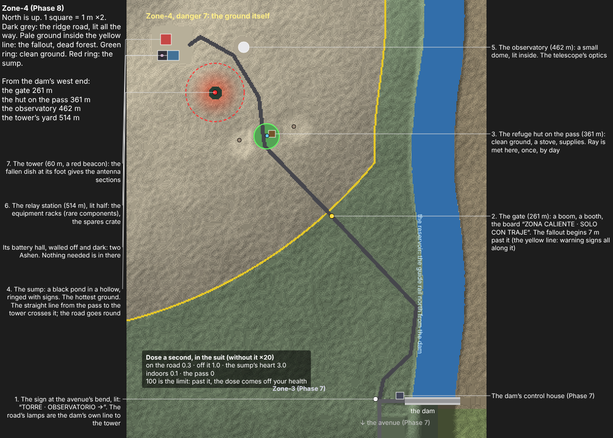

# Phase 8 — Zone-4 and the uplink (M5)

_The lead's brief (2026-11-20). The phase session turns it into the full plan below it, as docs/PHASE7.md did, and marks each step DONE._

The aim: the tower you have seen on the far ridge since your first walk in the buffer is finally reached. It stands in the mountains of the north-west corner (`zone4`: x < 450, z < 450; `PLACES.ridgeTower` at 360, 380). The ground on the way is poisoned. On the ridge are the things the uplink needs. Bringing them home completes **M5, the uplink**: the builder's computer asks the thing that still runs the satellites, and it answers. That answer is the end of the story this version tells.

## What the owner taught us

Simple, short, well lit, easy to find. Nothing hidden that looks like everything around it. So:
- **One road.** It leaves a place the player already knows, is signed there, and every place of the phase stands on it in the order walked.
- **Radiation is read at a glance.** Poisoned ground is marked the way Zone-2's rings are, and looks different from clean ground. The dose is shown the whole time you are in it.
- **Nothing needed is in the dark.** The dark holds only danger.
- **A toast** says what can be done at each place, the first time.

## Design calls (the lead's; the owner has handed these over)

- **The way in is from Zone-3**: a signed road from the avenue's bend by the dam's west end, north along the reservoir's west shore, then up a pass to the ridge. *Why:* PLAN.md's "mountain pass"; it starts where Phase 7 ended, and the reservoir is a guide rail nobody can lose. Keep the walk from the dam to the tower near 450 m.
- **The danger is the ground, not a crowd.** Danger 7 is radiation that kills a careless player in minutes, managed by three things the player can see and choose: a **suit**, **medicine**, and the **route** (the road is the least poisoned line; shortcuts cost dose). A few Ashen at most, in one dark place, by Phase 7's rules. No new kind of enemy. *Why:* the script's fights are small and slow, and a second new enemy this late would be learnt and never used again.
- **The suit is earned before the pass**, from what Zones 2 and 3 already give, on Ray's word. Without it the pass is a wall the player can read, never a surprise death.
- **Three places on the ridge**, each lit by what still runs there:
  1. **The relay station** at the tower's foot: the antenna sections, the rare components.
  2. **The observatory**, a small dome: the telescope's optics.
  3. **A refuge hut** on the pass, clean ground, a stove: the place to rest, and where **Ray** is met, once, by day. He hands over what his drawings could not.
- **M5 at home**, each a thing the player builds and sees:
  - the satellite antenna (on the cliff above the cave, seen from the valley floor);
  - the uplink terminal on the builder's computer (needs hydro running);
  - the telescope on the balcony: you look through it (the tower, the dam, the moon), and it is part of the uplink;
  - the medical bench and distiller, and rare medicines (never an Ashen cure);
  - from the AGI's schematics: a thermal optic, sonic and chemical means against the Ashen, engineer's armour.
- **The AGI never speaks.** A query screen, not a chat: you pick a query, and it returns coordinates, times, tables and diagrams. Each answer changes something in the game: radiation drawn on the map table, where the Ashen are tonight, a schematic unlocked. No sentences, no name, no personality.
- **The ending.** The first answer is the closing beat: a short, quiet card that says what the player has done, names what is still out there (Mira; the people on the phone), and returns them to the valley to play on. Phase 9 polishes it.
- **Infection stays out** (as in Phase 7). **The compound stays closed.**
- **Zone-4's land may change** inside the corner and along the new road. Everything east of the gorge stays as pinned by the fixtures.

## Order of work

1. This plan in full, with the map (`docs/phase8-map.png`, drawn from the layout), in the phase's first commit. Build to it without waiting for the owner.
2. Land and places (`src/gen/layout.ts`, a new `src/gen/zone4.ts`), with world-hash fixtures for what must not move.
3. **Then stop and merge `main`** before touching `src/game.ts`: the review's fixes are splitting that file (docs/REVIEW.md, N10) and the home makeover is changing the cave. The lead says when both are in.
4. Radiation, the suit and medicine; the places' salvage; Ray's meeting.
5. M5 at home; the AGI's query screen; the ending card.
6. The play-through part (`tests/e2e/play-zone4.mjs`), the fresh review, the report to the lead.

---

# The plan (the phase session, 2026-11-20)

Each step is committed with its tests and marked DONE under "Progress".

## The map

`docs/phase8-map.png`, drawn from the layout itself by `tools/zone4map.ts`. North is up. Every number below is in `ZONE4` (`src/gen/layout.ts`).

**One road, the ridge road.** It is 494 m long, four wide, and lit the whole way: its lamp posts are the dam's own power line to the tower, which is why the tower's beacon still burns. Every place of the phase stands on it, in the order walked.

| From the dam's west end | Distance | Height |
|---|---|---|
| The sign at the avenue's bend | 26 m | 83 |
| The reservoir's shore (the water in sight for 50 m, a parapet on its side, a landing with steps to the water) | 85–134 m | 83–87 |
| The gate | 260 m | 87 |
| The hut on the pass | 366 m | 109 |
| The observatory | 467 m | 120 |
| The tower's yard and the relay station | 520 m | 127 |

*The brief asked for "near 450 m". It is 520.* Straight from the bend to the tower is 432 m; the rest buys the run along the water's edge the brief asks for and the arc round the sump. The way home is hold H.

**How a first-time player finds each place:**
1. **The sign.** Walking off the dam, dead ahead at the bend where the avenue turns south: a lit board, "TORRE · OBSERVATORIO →", a radiation trefoil under it. A lit road runs north. The player has stood at this bend before: it is where the first Ashen was seen. The first time: a toast names the ridge road.
2. **The shore.** The road swings to the reservoir's rim: water on the right, the dam behind. No Ashen come here (their nests are 60 m and more south of the dam, and they roam 14 m).
3. **The gate** (260 m). Barriers to walk round, a booth, and a board over the road as wide as the road: "ZONA CALIENTE · SOLO CON TRAJE" (hot zone, suit only). Beyond it the forest is dead: grey ground, bare trunks, no leaf. A line of warning signs runs along the edge of the dead ground both ways as far as you can see, as round Zone-2's rings. The first time: a toast says what the ground does, and how long you would last. Without the suit the dose meter says so in red.
4. **The climb.** 100 m up the dead slope under the lamps. The tower stands on the skyline ahead the whole way.
5. **The hut on the pass** (366 m). The road tops out between two rocky knolls. On the right a stone hut, "REFUGIO", a lantern over its door, smoke from its stove pipe. Round it the ground is green: grass and one living tree inside a ring of green boards, "ZONA LIMPIA". The dose meter stops. **Ray is met here.**
6. **The sump** (on the left after the pass). The ridge opens: a hollow with a black pond in it, yellow drums round the pond, a ring of signs and tape. The tower is straight across it, 130 m off. The road bends right, round the hollow's rim.
7. **The observatory** (467 m). A white dome on a knoll on the road's right, its telescope's tube out through the slit, a lamp over its door, red light inside.
8. **The tower's yard** (520 m). The road ends at the tower's feet: four steel legs 11 m apart, 60 m of lattice, a red beacon. A fallen dish lies in the yard. On the yard's south side the relay station, "ESTACIÓN DE ENLACE", a lit door.

## Design calls (the phase session's; each with its reason)

- **Zone-4 is the massif, not a square.** The zone is the ground under the fallout: within 484 m of the corner's mountain centre (200, 200), and no nearer the gorge than 60 m. It was the box x < 450, z < 450. *Why:* the gate has to stand where the zone begins, and a climb plus a ridge needs 250 m of road inside it. The old dome of mountains already reached this far.
- **The ridge is lower than the old dome, and it is a ridge.** The dome was a smooth cap 172 high with the tower's foot at 166. The world is 192 high, so a 60 m tower built of blocks could not stand there. Now the land climbs from the reservoir (86) to a crest at 128 with the tower on it, falls to a high dead valley behind (107), and rises to the far peaks (150 and more) toward the corner. From the dam the upper three quarters of the tower stand against the sky.
- **The tower is built of blocks, 60 m high** (it was a 64 m drawing in the sky). From far off the same frame is still drawn as a thin shape; within 150 m only the blocks are.
- **The land east of the gorge, the reservoir and its shores, the dam and everything on the avenue are unchanged.** West of the gorge only the massif and the ridge road's corridor change. Pinned by fixtures (below).
- **Dose past 100 comes off your health, one for one.** Until now the dose stopped at 100 and never killed. *Why:* the brief's danger 7 "kills a careless player in minutes", and one rule is easier to read than two. It holds in Zone-2's rings too: stand 35 s in the van's heart and it starts to hurt; one step out and it stops. The cap on health (100 − 0.6 × dose, never under 40) stays.
- **The suit is carried, like armour.** A hazard suit in the pack is worn. It lets a fortieth of the dose through, in Zone-2 as well.
- **No new enemy; two Ashen.** They keep the relay station's battery hall, walled off from the lit half, by Phase 7's rules. Nothing needed is in there.
- **Ray's meeting is the suit's reward, not its gate.** Ray tells you how to make the suit by phone. Once you carry one he will meet you at the hut, once, by day. He gives the satellite modem: the dam's old telemetry link and its keys, which no drawing can give.
- **The telescope is true.** Looking through it is a real 12× look from where it stands, with a label when a known thing is in the cross-hairs. From the balcony the valley's rim hides the tower and the dam (the rim stands 10° up; the tower's top 4°). So from the balcony it shows the falls, the moon and the satellites' train; carried up onto the plateau round the valley's north and east rim it shows the tower, 1.4 km off (a unit test finds the sight lines). The dam lies in its gorge and shows only from near it. *Why not a fixed picture of the tower:* a view that could not be true from where you stand is the one thing a block game should not fake.
- **The antenna is mounted, not placed.** The builder left a hoist on the balcony. Right-click it with the assembled antenna and the dish stands on the cliff's edge above the cave's mouth: a mast and a 5 m dish, seen from the garden and the pool. *Why:* a one-block dish would not be seen from the valley floor, and there is no way to climb up there.
- **The link's first answer comes unasked**: the list of handsets it has heard. That is what a link does first, and it is what the ending needs (Mira is on it). Then the queries.
- **The sonic and chemical means are things you set down**, not ammunition: a sonic lure that draws the Ashen to it, and a smoke pot they will not come near. *Why:* both reuse rules the Ashen already have (a shot draws them to where it was fired; ground they never step on), and both fit a zone where the right answer is not to fight.
- **Infection stays out. The compound stays closed.** (The brief.)

## 1. The land (`src/gen/layout.ts`, `ZONE4`; blocks: `src/gen/zone4.ts`)

| Place | Where | What is there |
|---|---|---|
| **The sign** | x 576, z 750–751, facing east | A two-wide board on posts, two lanterns: "TORRE · OBSERVATORIO →" and the trefoil. |
| **The ridge road** | (580, 750) → (584, 730) → (612, 704) → (618, 655) → (537, 574) → (537, 556) → (462, 490) → (456, 440) → (430, 397) → (396, 378) → (385, 386) | Cracked asphalt four wide, never more than one block up in two metres, a level landing at each bend. A lamp every 8 m, either side in turn, so their pools meet (Phase 7's lesson). No trees within 6 m; none between the road and the water. |
| **The shore** | along (612, 704) → (618, 655) | A concrete parapet on the water's side. Halfway, **the landing**: ten steps down the bank northward from z 691, the last two under the water. *Why:* the reservoir's banks are three blocks sheer; someone who falls in beside the road needs a way out. |
| **The gate** | (537, 563), on a straight run north | The board on a gantry over the road, concrete barriers to walk round, a booth (a shelf: one box of tablets), lanterns. The fallout begins 13 m past it. |
| **The edge** | 484 m from (200, 200); x = gorge − 60 on the east | A warning sign every 16 m along the whole line, facing out. Inside it: dead ground, bare trunks, no plants. |
| **The pass** | (462, 490), height 109 | Two knolls 14 m high either side. Clean ground: a circle of 13 m round (464, 480), marked with green boards, grass, one living tree. |
| **The refuge hut** | x 466–472, z 474–480 | Stone and timber, one room, a door on the road. A stove (it cooks), a table and bench, a bedroll, a crate (food, water, tablets, bandages), the wardens' log (a note). A lantern inside and out. |
| **The sump** | (418, 430), ring 22 m | A hollow 9 m deep that falls evenly from the road's edge, so the pond is seen from the road: black sludge 14 m across, yellow waste drums, a ring of signs and tape posts. The hottest ground: 120 a second at its heart without a suit. |
| **The observatory** | (440, 388), a drum 11 m across | A concrete drum and a white dome with a slit toward the road, the telescope's tube out through it. Inside, lit: the telescope on its pier (mine it for the optics), a desk with the observers' last page (a note), a crate (glass, wiring). The door faces the road. |
| **The tower's yard** | x 348–385, z 368–403, height 127 | Gravel, lamps. The tower at (360, 380): four legs, braced, 60 m, a red beacon at the top and one halfway. The fallen dish: three panels (mine each for an antenna section). |
| **The relay station** | x 352–373, z 392–401 | Lit half (east, the door on the yard): six equipment racks (mine each for rare components), the spares crate (wiring, fittings, cells, tablets, one more antenna section), the field pharmacy manual on its shelf (read it: the medical bench and the distiller), solar panels on the roof. Dark half (west, its own open bay in the west wall, a baffle wall inside so no daylight reaches the far end): the battery hall, two Ashen. |

**Rock:** no cave opens under the road or the places. Ore under Zone-4 is as elsewhere.

**Far off:** Zone-4 is drawn as grey dead slopes, so the ridge reads as poisoned from the dam and the highway.

**Fixtures** (`tools/worldhash.ts`):
- East of the gorge: `tests/fixtures/east-of-ravine.json` and `east-rim.json`, as before. Nothing new may differ.
- Zone-3's built places: `tests/fixtures/zone3-places.json` (66 columns, x 480–671, z 704–1055, hashed on `main` at bf3efa6, with the fixes in). Only the columns the ridge road's first stretch crosses may differ.
- West of the gorge, outside the massif: `tests/fixtures/west-outside-massif.json` (hashed on `main` at bf3efa6, with the fixes in). Only the shore road's columns may differ.

## 2. Radiation, the suit and medicine (`src/sim/radiation.ts`, pure)

**The dose a second** (`falloutAt` in the layout):

| Where | Without a suit | In the suit |
|---|---|---|
| The pass's clean ground; everywhere outside the line of signs | 0 | 0 |
| Indoors (the station, the observatory) | 4 | 0.1 |
| On the road, the yard, the observatory's step | 12 | 0.3 |
| Off the road (it climbs from the road's edge over 8 m) | 40 | 1 |
| The sump: its ring to its heart | 40–120 | 1–3 |
| The first 20 m inside the line of signs | 30% of the above, climbing | |

- **The limit is 100.** Dose past it comes off health, one for one. Health is capped at 100 − 0.6 × dose (never under 40), as before. The dose fades by 4 a game day, as before.
- **Without a suit** the road gives 12 a second: the limit ten seconds past the signs, death three seconds after. The hut's clean ground is 80 m in: 20 s at a walk, 14 at a run. Nobody reaches it; a unit test walks and runs it. So the gate is a wall, and the meter says so in red ("NO SUIT · limit in 0:08"). The first 20 m inside the signs are weaker, so a few steps in and back out cost a third of the limit, not a life. *Changed from the first draft:* at half this strength (and a suit that let a twentieth through) a runner reached the hut alive with a dose of 100 and 30 health, stranded.
- **In the suit**, walking the road: gate to hut 8, hut to tower 11. A careful trip there and back with the work indoors: about 45. Crossing the sump instead of going round: about 35 more, to save six seconds.
- **The meter** shows the whole time you are in Zone-4 or have a dose: the dose, its rate ("+0.3/s"), "suit" or "no suit", and the time to the limit at this rate. The Geiger counter clicks by the rate, as in Zone-2.
- **The hazard suit** (`hazard_suit`): workbench, canvas 4, scrap lead 4, glass 1, charcoal 2. The recipe shows once Ray has given his word (`suit_word`). Everything in it comes from Zones 1–3 and the kiln.
- **Blue tablets** (`rad_tablets`): use one, the dose drops by 30. Found: the gate's booth (1), the hut's crate (2), the station's spares (2); Ray gives 2 at the meeting and sells more; made at the medical bench.
- **Doc's rad treatment** stays: the whole dose, for his fee.
- **Flying in Builder's mode** takes no dose, as before.

## 3. Ray (`data/people.json`; the phone; the hut)

1. **His word.** The first call after he has given the uplink plans: he tells you what the ridge is, to follow his lamps, and how to make the suit. The recipe shows. If you reach the gate first, its toast tells you to call him.
2. **The meeting.** Once you carry a suit, his contact has a second button: "Ask Ray to meet you at the refuge". He says he will be there by day. From then he stands by the hut's door, 06:00–18:00, until you have met. He wears his own suit: orange, the hood down, a white hard hat, grey beard.
3. **Right-click him:** he hands over the **satellite modem** and two boxes of tablets, tells you the dish is in the yard, the optics in the dome and the racks in the station, and that he is going back down before dark. A page goes into your notes. He is not there again.
4. **His catalogue** gains, after the meeting: blue tablets, rare components, an antenna section (so nothing in M5 can be lost for good).
- He is never there at night, never anywhere but the hut's clean ground, and nothing hunts there (the Ashen's ground is the yard's west end, 150 m away).

## 4. Items, blocks and recipes (`data/*.json`, appended)

**Found on the ridge**

| Item | From |
|---|---|
| `antenna_section` | the fallen dish's three panels; one more in the spares crate |
| `rare_components` (amplifier, waveguide, oscillator) | the station's six racks |
| `telescope_optics` (the mirror and its cell) | the observatory's telescope |
| `sat_modem` | Ray |
| `rad_tablets` | the booth, the hut, the spares crate, Ray |

**M5's recipes**

| Station | Makes | From | Shows when |
|---|---|---|---|
| workbench | hazard suit | canvas 4, scrap lead 4, glass 1, charcoal 2 | Ray's word |
| workbench | satellite antenna | antenna section 3, steel ingot 4, wiring 2, pipe fittings 2 | Ray's uplink plans |
| lathe | telescope | telescope optics 1, steel ingot 2, glass 1, planks 2 | always |
| workbench | uplink terminal | satellite modem 1, rare components 2, wiring 4 (the plans kept) | Ray's uplink plans |
| workbench | medical bench | steel ingot 4, glass 4, rare components 1, wiring 2 | the pharmacy manual |
| workbench | distiller | copper 6, glass 2, pipe fittings 2, steel ingot 1 | the pharmacy manual |
| distiller | spirit ×2 | corn 4, water jug 1, charcoal 1 (the jug back) | |
| distiller | spirit ×2 | potato 4, water jug 1, charcoal 1 (the jug back) | |
| medical bench | blue tablets ×2 | spirit 1, iron ingot 1, herbs 2, charcoal 1 | |
| medical bench | antibiotics ×2 | spirit 1, herbs 3, honey 1 | |
| medical bench | adrenaline ×1 | spirit 1, coffee beans 4, salt 1 | |
| lathe | thermal optic | glass 2, rare components 1, battery cell 1, steel ingot 1 | its schematic |
| workbench | sonic lure ×2 | rare components 1, battery cell 1, wiring 2, scrap metal 2 | its schematic |
| powder mill | smoke pot ×2 | sulfur 2, saltpeter 1, charcoal 1, clay 1 | its schematic |
| lathe | engineer's armour | plate armour 1, steel ingot 4, rare components 1, canvas 2 | its schematic |

- **The medical bench and the distiller are stations, and work only while a hydro generator turns** (the script: hydro-gated). Without one they say why.
- **The medicines** (the script: rare drugs from before; never an Ashen cure, and the manual says so): blue tablets (dose −30); antibiotics (health back to the most the dose allows, at once); adrenaline (for 60 s blows hurt half as much and the focus meter is full).
- **Rare components:** six from the racks; M5 needs six if everything is built once (terminal 2, bench 1, optic 1, a pair of lures 1, armour 1). Ray sells more.
- **The thermal optic** (carried): in focus mode (Q) every warm body within 60 m is drawn bright through the dark, Ashen included, and never through rock.
- **The sonic lure** (set down, then right-click): it wails for 40 s. Every Ashen within 40 m that is not already hunting goes to it, as to a shot. Then it is spent.
- **The smoke pot** (set down, then right-click): for 60 s no Ashen steps within 8 m of it; one that is inside walks out. Then it is spent.
- **Engineer's armour** lets 35% of a blow through (plate 50%).

## 5. M5 at home

- **The antenna.** A hoist (`antenna_hoist`: a winch and a cable up the cliff) stands on the balcony from the start of the game; until M5 it says what it is for. With the assembled antenna in hand, right-click it: the mast and the dish are set on the cliff's edge above the cave's mouth (blocks, saved with the world). Its place is fixed by the layout once the home makeover is merged.
- **The telescope.** A block, set down anywhere. Right-click to look: 12×, drag to aim, Esc to leave. Labels in the cross-hairs: the falls, the moon, the satellites (a train of four crossing every few minutes at night), the ridge tower, the dam. It counts for the uplink when it stands under open sky in the home's grounds.
- **The uplink terminal.** With it in hand, right-click the builder's computer: it is fitted. The computer gains an "Uplink" page listing what the link needs, each with a tick: the antenna on the cliff; the telescope under the sky; a hydro generator turning; the terminal fitted. When all four hold: "Open the link".
- **The medical bench and the distiller**, by the workshop like any station.

## 6. The uplink (`src/sim/uplink.ts`, pure; the screen in `src/ui/`)

**It never speaks.** Every answer is rows of numbers, coordinates, times, and diagrams drawn in characters. No sentence, no name, no greeting, no "I". The page's own labels are the builder's software, in capitals, terse: `LINK`, `QUERY`, `ROWS`, `NEXT WINDOW`.

**Opening the link**, the first time: the screen counts the handshake (`CARRIER … LOCK … KEY ACCEPTED`), then prints, unasked, the first answer:

`ENDPOINTS HEARD · LAST 3000 d` — one row for each handset the satellites have heard: an id, a position (bearing and distance from here), the last fix (days ago), a state.
- Three that answer: the trader's, the doctor's, the engineer's (the ids on the builder's phone).
- This one: `HERE`.
- Five that stopped within a week of each other, some 2,920 days ago: the builder's contacts, and his own second handset (`HV-02`). That one and Lucía's last answered from the same position on the coast road, his two days after hers. Nothing is said about it.
- One nobody has on the phone: `MIRA-7`, 212 km north, a fix 0 days old, state `BEACON · REPEATING`.

**That is the ending** (below). After it, the queries:

| Query | It returns | What it changes |
|---|---|---|
| `RAD` | a grid of the dose over the ridge, cell by cell, and the least-dose line as coordinates | The map table draws the fallout, the sump and the road through it. The dose meter adds the dose the rest of the road will cost at this pace. |
| `BIO` | a table: each nest's position, count, and the hours they are out tonight | The map table marks the nests. A chip on the screen warns within 40 m of one ("nest 32 m"). |
| `EPH` | three days of sunrise, sunset, moon, the valley's mist hours | Outside the valley the clock shows the time left to dusk. |
| `SCH` | an index of four drawings; each request returns one: a diagram in characters and a parts table | That recipe shows at its station: the thermal optic, the sonic lure, the smoke pot, the engineer's armour. One drawing a link window (six game hours: `NEXT WINDOW 14:20`). |
| `END` | the endpoints table again, with today's fixes | Mira's beacon is on the phone (no voice: a position) and on the map table's edge as a bearing. |

- Every query but `SCH` answers at once, as often as asked.
- With the hydro stopped, the antenna gone or the telescope moved indoors, the page says which is missing and the queries are greyed.

## 7. The ending

The first answer is the closing beat. When the endpoints table has been read and closed, the screen goes dark and a card comes up, white on black, one line at a time:

> It answered.
>
> Not a voice. Positions, times, a list. Whatever keeps the satellites alive does not care who asks. It answered you.
>
> You came up out of the water with nothing. Now a wheel turns in the creek, a dish stands on the cliff, and nobody has found the valley.
>
> Still out there: Marco on his road. Doc on a bad line. Ray, who left his dam and still listens for it.
> A handset called Mira, far to the north, calling and calling.
> Two that stopped at one place on the coast road, two days apart, eight years ago.
>
> The valley is yours. The rest is waiting.

One button: "Back to the valley". The game goes on; the queries are open; a page goes into the notes. The card shows once (`ending_seen`); "The story so far" on the computer shows it again. Phase 9 polishes it.

## 8. M5 on the computer (`src/sim/m5.ts`)

| DESIGN.md's row | Here: done when |
|---|---|
| (the run) | you reach the tower's yard and come home alive |
| the Ray meetup | you have met Ray at the refuge |
| 1. Satellite antenna | the antenna stands on the cliff |
| 7. Telescope | a telescope stands under the sky at home |
| 2. Uplink terminal | the link has been opened (the terminal fitted, hydro turning) |
| 3 and 6. The query interface and what it gives | you have asked it something beyond the first answer |
| 4 and 5. Medical bench, distiller, rare medicines | you have made a medicine |
| 8. The weapons package | you have built from one of its drawings (optic, lure or pot) |
| 9. Engineer's armour | you have made it |

When all are done: *"M5 · the uplink. Everything the builder began is running. What comes next is not in his drawings."* and a page in the notes. Dying outside before reaching home from the yard means walking the run again, as in M3 and M4.

## 9. Small things that go with it

- **Old saves.** New flags default. A save made on the old dome, which stood up to 45 m higher, loads in the air: once the land is in, a player with nothing under them for more than three blocks is set on the surface, as a buried one already is.
- **Zone-4's toast** fires at the gate, and for anyone who walks in over the signs elsewhere.
- **The far tower** keeps its place on the skyline. By the land's lie it shows from the old road west of the saddle (nine tenths of it and more from x 1,050 to the bridge) and from the highway and the dam, as the taller drawing did; from the buffer's road the saddle's knolls hide it, as they hid the old one (a unit test checks both).
- **Sound:** the wind on the ridge (it already rises with height); the Geiger; the beacon's slow tick near the tower; a short modem handshake when the link opens.

## 10. The play-through

`tests/e2e/play-zone4.mjs`, a sixth part run by `play.mjs`: the sign at the bend and its toast; the shore; the gate without a suit (the meter's warning, the dose climbing, turn back alive); Ray's word and the suit made; the gate in the suit; the pass, the meter still, the stove; Ray met, the modem in the pack; round the sump (and a step into its ring: the rate); the observatory's optics; the yard, a dish panel and a rack mined with the two Ashen behind their wall (none stirs); a tablet; home; the antenna hoisted and seen from the garden; the telescope looked through; the terminal fitted; the link opened; the first answer; the ending card and back to the valley; a query that changes the map table; a drawing and its recipe; M5's ticks.

## Checks

**Unit tests** (`tests/phase8.test.ts`)
- The ridge road never steps more than a block; each place stands on level ground beside it; every place is built, lit and signed; the road's centre line is never darker than 7 of 15 at night; no cave under them; no tree on the road.
- The tower is whole from its feet to its beacon and fits under the sky; the drawn frame and the blocks are the same frame.
- Fixtures: east of the gorge as before; Zone-3's places but for the junction; west of the gorge outside the massif but for the shore road.
- The fallout: nothing outside the signs, on the pass, or east of the gorge; the table above, cell by cell along the road; the road is the least-dose way from the pass to the yard; the sump's line costs more.
- Dose: the suit's twentieth; past 100 it comes off health; without a suit a walker dies before the hut; in the suit a walker reaches the tower and home under 60; tablets; the cap; fading; Zone-2's rings by the same rule.
- Zero hostile spawns in the sanctuary over 100,000 tries with Zone-4 in; the relay's two Ashen keep Phase 7's rules on the generated land (behind their wall by day with a player working in the lit half; out by their own bay; never on the pass).
- The lure draws, the pot repels and both run out; the thermal optic lists what it would show.
- Each M5 recipe resolves and gates; each M5 step ticks; the uplink's page lists what is missing; every query's answer is rows and never a sentence (no lower-case word runs, no "I", no name); the first answer holds Mira and the builder's contacts; each query sets its change.
- The telescope's labels: what is in the cross-hairs from the balcony and from the rim.
- Old saves load: the new state defaults; a player in the air is set down.

**Screenshots** from a first-time player's eye: the sign at the bend; the shore road with the dam behind; the gate and the dead forest; the pass and the hut by day with Ray; the sump from the road; the observatory at dusk; the tower from the yard, looking up; the station's lit half; the dish above the cave from the garden; the uplink's first answer; the ending card.

## Build order

1. This plan, the map and the layout's numbers. DONE first.
2. The land: `src/gen/zone4.ts`, the tower's frame, textures for the new blocks, the far land, fixtures and their tests.
3. **Stop before `src/game.ts`.** Until the lead says the fixes and the home makeover are merged, only: the data (appended), icons and textures, and the pure logic with unit tests: radiation and the suit; the uplink's tables; M5's tracker; the lure and the pot; the telescope's aim; the relay's nest in the Ashen's list.
4. Merge `origin/main`. Wire: the meter, the suit and tablets; the places' toasts and salvage; Ray's word, the meeting, his catalogue.
5. M5 at home: the hoist and the antenna, the telescope, the terminal and the uplink page, the medical bench and the distiller, the drawings' things.
6. The ending card.
7. The play-through part, pictures, the fresh review and its fixes, the report to the lead.

## Progress

- **DONE: The plan, the map and the layout's numbers** (`ZONE4` in `src/gen/layout.ts`; `tools/zone4map.ts`). The ridge's shape, the road's line and heights, the fallout's field (`falloutAt`, folded into `radiationAt`) and Zone-4's new bounds are in. Baselines of the land as it was are in `tests/fixtures/zone3-places.json` and `tests/fixtures/west-outside-massif.json`. All 396 unit tests of the earlier phases pass with it.
- **DONE: The land** (`src/gen/zone4.ts`, `src/gen/towerFrame.ts`), built to the map, with pictures looked at and faults in them fixed.
  - The sign, the shore road with its parapet and landing, the gate, the line of warning signs (74 of them), the dead slope (grey ground, bare trunks, no moss), the pass with the hut and its green pocket, the sump, the observatory, the yard with the tower (about 900 blocks of lattice steel that cannot be mined, two beacons), the fallen dish and the relay station.
  - *Changed from the first draft of the plan:* the road runs straight north for 18 m through the gate, so the board and barriers stand square to it. The sump moved 9 m toward the road and its hollow is a cone, not a bowl: from the road the pond was hidden behind the hollow's own lip. The battery hall has a baffle wall: without it daylight from the bay reached the far end. The road hugs the reservoir's rim (it stood 45 m back, from where the water cannot be seen), with a parapet and a landing.
  - Far off, Zone-4 is drawn as grey ground with no canopy, and the pass's green pocket shows in it.
  - The tower drawn in the sky is the same frame as the blocks (`towerBeams`), upright, and is left out within 150 m.
  - The data for the whole phase is in (`data/*.json`, appended): 27 blocks, 13 items, 15 recipes, Ray's later catalogue; with textures and icons. The medical bench and the distiller are stations.
  - Checks: `tests/phase8.test.ts`, 37 tests (layout, bounds, the fallout's table, the tower's frame, the three fixtures, every place built and lit). 424 columns of the world differ from `main`: none east of the gorge, none in the gorge's own column, 13 outside the massif (all on the road).
- **DONE: The dose, the suit, the tablets** (`src/sim/radiation.ts`, pure, tested). *Changed from the first draft:* the fallout is twice as strong and the suit lets a fortieth through (the suited numbers are the same). At the first numbers a runner without a suit reached the hut alive, at the limit, with no way back.
- **DONE, waiting to be wired: the pure logic** for everything after the merge, each with tests:
  - the uplink (`src/sim/uplink.ts`): what the link needs; the first answer (the handsets); `RAD`, `BIO`, `EPH`, `SCH` and the four drawings, each row checked for speech (`spoken`): no lower case, no sentence, no word a speaker uses, no name;
  - M5's nine steps (`src/sim/m5.ts`);
  - the sonic lure and the smoke pot (`src/sim/countermeasures.ts`), and the Ashen's part of them (`src/entity/ashen.ts`: `smoke` in their senses; a lure is `ashenHear`);
  - the relay station's nest: eleven Ashen in six nests (`NESTS`); the ridge is theirs only within 50 m of the nest, never the pass. Tested on the generated land: neither wakes for a walker in the yard or a pick in the lit half; a runner brings them out round the baffle and by their bay; at night they keep to the yard's west end;
  - the telescope's aiming (`src/sim/telescope.ts`): bearings, sight lines over the land, the moon, the satellites' train, what the cross-hairs are on.
  - Unit tests: 485 in all (89 in `tests/phase8.test.ts`).
  - Also ready: Ray's lines and the eight notes (`data/people.json`, `data/journal.json`), the closing card's words (`data/ending.json`), the ridge's places and Ray's calls (`src/sim/ridge.ts`), the medicines (`src/sim/medicine.ts`), the antenna's blocks (`src/gen/antenna.ts`), and three screens as files of their own: the uplink page, the closing card, the telescope's field (`src/ui/uplinkScreen.ts`, `endingCard.ts`, `scopeView.ts`). 495 unit tests.
  - The far tower is drawn three times as thick as steel, with half the haze and its two red beacons: from the dam its top and its light stand over the forest by day, and the light shows at night.
- **WAITING: the lead's word that the fixes and the home makeover are in `main`.** Nothing in `src/game.ts`, the HUD or the home has been touched. After the merge: steps 4–7 of the build order.
