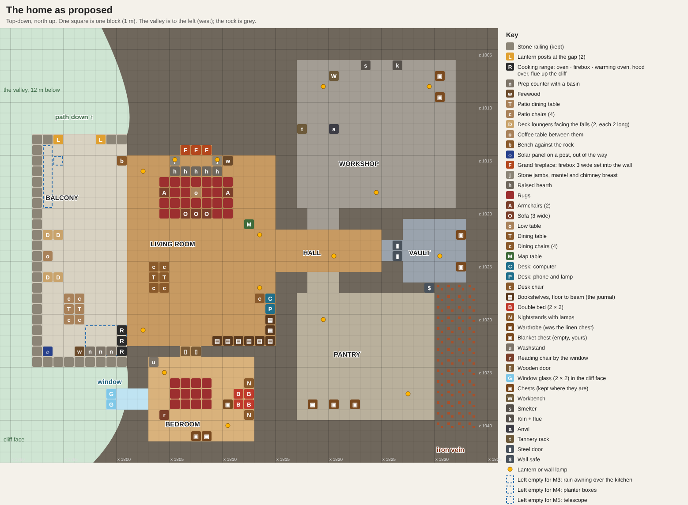
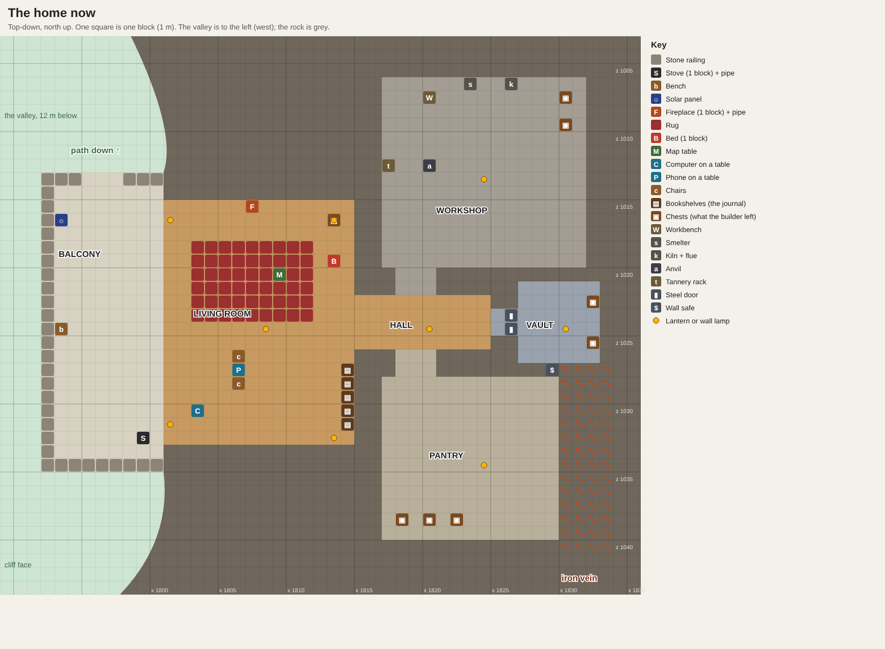

# Independent review — Hidden Valley, Block Edition

_**Draft in progress:** the zones, creatures and interface are still to be judged, and the play-test findings added._
_Reviewed: `main` at `a1b0772` (Phases 0–6, published as version 9), on 2026-11-19. Phase 7 is not covered._
_Nothing in the game was changed. This file and the pictures in `docs/review/` are the only things added._

---

## For the owner

### The verdict

**The game is mostly sound, and it can be greatly improved. Both are true, in different places.**

- **Keep what is underneath.** The world, the light, the water, the way blocks load and the hard rule that nothing hostile enters the valley are well built. Nothing here needs rewriting. The valley from the pool and the home seen from the garden are good pictures by any standard.
- **The writing is good.** The journal, the dead contacts on the phone, the body across the ravine and the tracks carry the script's tone better than I expected.
- **What is weak is the game laid over them.** Today it is a beautiful place with a good story and almost no pressure:
  - money never runs short, so the Bitcoin rig earns less than selling iron;
  - food and water never matter;
  - the milestones are a list of ticks that can be earned out of order, or made impossible by one sale;
  - the keys for flying, endless blocks and changing the time of day are ordinary keys in the menu, so any fight can be skipped.
- **The inside of the home looks unfinished.** Your notes on it are right; a plan is below.
- **Saves are not safe enough for other people yet.** I found four ways to lose a valley. None is likely on your Mac on a normal day, and you have said test saves don't matter, but they must be closed before anyone else plays.

### Grades

| Area | Grade | In one line |
|---|---|---|
| Bugs | **B−** | No crashes and the sanctuary holds, but saves can be lost and there are a few places to get stuck. |
| Code | **B−** | The engine is a B+; the one big file that runs the game is a C and has no tests. |
| Graphics and feel | **B−** | Outdoors B+; the rooms of the home, under water and the lack of a hand or tool on screen pull it down. |
| Gameplay against the script | **C+** | Places and story are faithful (A−); stakes, money and pacing are not there yet (C). |

### The five things most worth doing

1. **Make saves safe** (about 13 hours). Close the four ways a valley can be lost, keep a backup copy, and save your position and health on a timer, which the game does not do today.
2. **Give the game stakes** (about 15 hours, and several choices that are yours). Split "Survival" from "Builder's mode" so flying and time-skipping are a choice made once, not a stray key. Make money matter. Make milestones real steps that cannot be skipped or broken.
3. **Rebuild the home** to your notes (about 17 hours). The plan and sketch are below.
4. **Walk the whole world by machine and fix the traps** (about 11 hours). A test that walks every route would have caught the pit beside your path, the hole in the valley floor and the way round the "impassable" ravine.
5. **Build the first ten minutes** (about 7 hours). The game opens with no word of who you are, what to do first, or how to eat. Put the next goal on screen.

After those, in Phase 9: a setting for weaker computers, the look under water, a hand and tool on screen, and the valley life the script promises (fruit trees, hummingbirds, the quetzal, rain).

### The five worst bugs

1. **A lost valley.** If the browser is slow to open its storage just once, the game quietly starts a new valley, and the next time you play your real one is overwritten.
2. **A broken save file stops the game for good.** Loading a damaged save file or code replaces your save first and checks it second; after that the page shows "couldn't start" every time.
3. **A pit beside the path.** One step east of the top of the path down from the balcony is a slot seven blocks deep. You cannot climb out.
4. **One sale can end your progress.** There is exactly one pump in the world. Marco will buy it, and then the "fridge and pump" step of M3 can never be done. The same is true of several other parts.
5. **The `[` key prints money.** It is listed in the menu as "time of day back an hour". With a mining rig running, each press pays almost a full day's Bitcoin.

Next worst: the ravine at the end of the road, meant to be impassable, can be walked round in two minutes to the body and into Zone 3.

### The home, in a few lines

- **Fireplace:** a real hearth on the living room's north wall, five blocks wide. The fire sits in an opening three wide and two high, set back into the rock, with stone sides, a timber mantel, a stone chimney breast to the ceiling and a chimney that comes out on the plateau with smoke.
- **Stove:** a cast-iron cooking range three blocks wide against the rock at the balcony's south end: oven, firebox, warming oven, a hood over it and the flue up the cliff. A stone counter beside it.
- **Bedroom:** a new room south of the living room, ten by eight, with a wooden door, a double bed, nightstands, a wardrobe and a window cut through the cliff so you wake to the valley.
- **Furniture:** a sofa and two armchairs facing the fire, a dining table, a proper desk for the computer and phone, bookshelves from floor to beam, ceiling beams and wall lamps.
- **Patio:** two deck loungers at the railing facing the waterfall with a coffee table between them, and a dining table with four chairs near the stove. The middle stays clear so the view from inside is not blocked.
- **Left empty on purpose:** the places for the rain awning, the planter boxes and the telescope, which the script gives you as rewards later.
- **Cost:** about 17 hours of session work, in two sessions. **Old saves:** the game starts a fresh valley and says so; it never crashes.

The picture of the home as it is now is `review/home-now.png`. The full plan is in [The home redesign](#the-home-redesign).

---

## How the review was done

- **Built and checked:** `npm ci`, `tsc --noEmit` (clean), `vitest run` (304 of 304 pass), `vite build` (1.01 MB).
- **Read:** `AGENTS.md`, `PLAN.md`, `STATUS.md`, `PHASE2`–`PHASE6`, the script (`DESIGN.md`, 918 lines), and the source.
- **Six reviewers, one area each,** given the code and no conclusions: saves; the sanctuary and creatures; world, physics and light; money, progress and the script; code quality and speed; and one playing the built game in a browser with the real keys and mouse.
- **Every bug below was shown by running something.** The probes are not committed (they live in the review session's scratchpad), so each finding gives the steps and the output. The save probes run the real `Game` class with the renderer, HUD and sound stubbed, which shows that class can be tested.
- **Pictures:** about 60 taken; the ones that prove a point are in `docs/review/`.
- **Limits:**
  - The game runs in software rendering here, several times slower than real time. Frame rate and feel on a real machine were not measured.
  - I did not replay the repo's hour-long play-through.
  - "Needs browser" marks the few findings shown in a model of the world but not in the running page.

---

## Full findings

Costs are hours of session work. Risk is the risk of the fix.

### Worth doing now (before Phase 8)

#### N1. Saves can be lost, and most play is never saved

| # | What happens | Evidence | Where |
|---|---|---|---|
| a | **A slow storage open loses the valley.** `openIdb` gives up after 1.5 s and falls back to localStorage, which holds no save, so a fresh valley starts with no message. One edit and a close writes that fresh valley as the close-time copy. At the next start it is newer than the real save, so it wins and is written over the real one. | Probe G8: `session 1: indexeddb, wallet 9999999` → `session 2: store localstorage, wallet 5000000, toasts []` → `session 3: indexeddb, wallet 5000000`. | `src/platform/storage.ts:69`, `src/game.ts:261-268` |
| b | **The hot hand-over can hand over a blank game.** The snapshot hook is registered before `boot()` has applied the save. A hand-over taken then, or after a failed boot, is an empty game at 0,0,0; the new page applies it and marks it unsaved. | Probe F5: `pre-boot snapshot: player {x:0,y:0,z:0}` → `store now: wallet 5000000 flags []`. | `src/main.ts:86`, `src/game.ts:258` |
| c | **A save with the right header and missing fields bricks the page.** The import is stored before it is applied; `applySave` throws; every later start throws in `boot()`. | Probe F2: `import threw: TypeError … reading 'map'` → `next boot threw: TypeError`. | `src/game.ts:1527`, `:266`, `src/save/save.ts:124-126` |
| d | **Position, health, hunger, thirst, hour and dose are saved only when something counts as an "edit".** Autosave and the close-time save both require `editCount !== savedCount`. Pausing does not save. | Probe F1: live `x 1396, hp 12, hour 22.5`; on disk `x 1796, hp 100, hour 16.5`; no close-time write. The menu's "saves every minute" is not true. | `src/game.ts:379`, `:1480` |
| e | **An unreadable save is silently replaced** by a fresh game at the first autosave. | Probe F3: `booted fresh, toasts []` → `store after first autosave: wallet 5000000`. | `src/game.ts:262-266` |
| f | **Two tabs: the stale one wins**, with no warning. | Probe G10: `tab A saved wallet 900000` → after one edit in tab B `stored wallet 100`. | `src/game.ts:1457-1476` |
| g | **A failed write is silent.** The status line still says "Saves automatically". | Probe F4 (localStorage over quota). | `src/game.ts:1470-1473` |
| h | Small ones, all shown: "Copy save code" after New game or Load gives the **old** valley until the next pause; "Save now" before the store opens leaves autosave off for the session; New game keeps Zone-2's dead men; a pack saved with an item on the cursor and no room grows to 37 slots for good; a mined hutch leaves its 9-slot size for the chest placed there next. | Probes G6b, G6c, G9, W3. | `src/game.ts:1404`, `:1517`, `:1545-1574`; `src/world/world.ts:74-80` |

- **The fix, as one piece of work:**
  1. Put all saved state in one plain object with `newState`, `toSave` and `fromSave`, so `snapshot`, `applySave` and `restart` can no longer drift apart.
  2. Validate and normalise in `fromSave`: types, finite numbers, position clamped into the world. Apply an import **before** storing it. Wrap boot's load in a try/catch that starts fresh, says so, and keeps the bad bytes under a second key.
  3. Give each valley an id and each save a counter. The close-time copy beats the stored save only when the id matches and the counter is higher. Never let a copy from one kind of store replace a save in another.
  4. Open IndexedDB without the 1.5 s fallback: show "opening your save…" and fall back only on a real error.
  5. Keep the previous save as a backup before a session's first overwrite.
  6. Save every 60 s while playing, on pause, and on hide, whether or not anything was edited.
  7. Hold a Web Lock while a tab is playing; a second tab says so.
  8. Return nothing from the hand-over snapshot until a save has been applied.
  9. Toast when a write fails.
- **Tests to add:** a full round-trip through `Game`; walk without editing, close, reload; malformed saves at boot and at import; a slow or failed store open with a save present; a hand-over taken before boot; two tabs.
- **Cost:** 13 h. **Risk:** medium (it touches start-up); the tests above are the safety net.
- **What is solid here:** edits and light match a regenerated world cell for cell; every saved field round-trips; no way to duplicate items was found; 100,000 edits is 0.3 MB.

#### N2. Flying, endless blocks and time-skipping are ordinary keys

- **What happens:**
  - `F` flies anywhere. While flying there is no hunger, drowning, fall damage, creature damage or radiation.
  - `G` gives endless blocks.
  - `[` and `]` move the clock. All four are in the menu's list of controls, and the menu still says "Phase 0".
  - `[` goes back one hour, which the power code reads as 23 hours forward: one press pays 47,916 sats from a 50,000-a-day rig. 100 presses pay 4.79 million.
  - A press of `[` before 06:00 counts as a new dawn each time: eggs, rabbits, jerky and Zone-2's dead men all come round again.
  - In builder's mode, mining the single raider forge removes it and gives no parts, which locks M2's forge.
- **Evidence:** economy probe P: `[ KEY: minutes stepped 1380 paid 47916 sats`; `five presses of [ starting 05:54 -> 5 new mornings`.
- **Where:** `src/game.ts:1333-1336`, `:1624`, `:502`, `:705`, `:1605`; `src/ui/hud.ts:202`, `:222-223`; `src/sim/interact.ts:35`.
- **Fix:** one choice, "Survival" or "Builder's mode", made at New game and shown in Settings. In Survival the four keys do nothing. In Builder's mode the time keys move the sky only: they never step power or start a day. Save the mode. Builder's mode still drops quest blocks.
- **Cost:** 3 h. **Risk:** low. **Owner's call:** whether Survival should keep any of the four.

#### N3. Places to get stuck, and a fence that isn't one

| # | What happens | Steps | Where | Fix, cost |
|---|---|---|---|---|
| a | **A 7-deep slot beside the top of the home path.** | From the balcony's north opening walk north to z≈1011.8 and step east. You land at (1798, 75, 1011) with 21 damage. 30 random 40-second escape runs never got above y 76.4. | `src/gen/terrain.ts:508-514`: the path is 3 wide (x 1795–1797), the cliff starts at x 1799, nothing fills between. | Fill between path and cliff along the first leg. 1 h. |
| b | **The "sheer" ravine can be walked round.** The far bank, the body and Zone 3 are open on foot, with no jump and no block placed. | From the road's end go south along x≈658 to z≈1085, down to the floor near (655, 42, 1174), north along the floor, up at x≈618, z 1100–1137, to the body at (597, 79, 1026). The real `Player` walked it in 140 s, and back in 138 s. | `src/gen/layout.ts:572-575`: blending gorge into slope makes a one-in-two ramp along each wall. | Make the change abrupt, or keep both walls more than one block per step; test that the far bank is unreachable. 2 h. |
| c | **A cave shaft in the valley floor** at the south-west cliff foot, and about 20 one-block pits. | Walk east from (1633.5, 72, 1103.5): you drop into a 47-cell cave. Escape topped out at y 70.4; the rim is 72. Others: (1770, 71, 1091); 13 gaps between bushes by the outpost, such as (864, 89, 1047); (1261, 130, 1153). | `src/gen/terrain.ts:210-211`: the cave roof margin is measured from the column's highest rock, not the ground at its foot. | Measure from the lowest open surface; fill 1×1 pits two or more deep. 2–3 h. |
| d | **That same cave runs 3–8 m past the sanctuary's line.** Inside it the game calls it buffer: a death there costs the pack, and "Lost? Hold H" appears. No hostile can reach it (a flood from outside shares no cell with it). | `nookpath` probe: `at the nook's end 1631.5,1115.5: zone buffer, a death there loses the pack: true, r = 114.3`. | `src/gen/terrain.ts:210-213`, `src/gen/layout.ts:327` | Fixed by (c), plus a test that a flood from the valley floor stays inside the sanctuary. |
| e | **The wake point is never checked.** Three blocks stacked on it, and death or H leaves you inside rock. A 22-deep shaft under it gave 24 deaths in 30 s. | Probe `misc`. Sleeping sets the wake point to wherever you stand when you click the bed, up to 5 blocks away. | `src/game.ts:735-737`, `:941`, `:1089-1094` | On wake or H, look for a free cell with ground under it near the wake point; else the balcony. Fix the wake point at the bedside. 1.5 h. |
| f | **The valley pool stands one block proud of its east bank:** 21 water cells with open air beside them, at x 1624–1627, z 1015–1021. | Probe `scan`. | `src/gen/terrain.ts:321-332` | Hold the ground at 70 or more within radius + 3 of the pool. 1 h. |
| g | 24 single limestone blocks hang in the air off the valley cliffs, such as (1604, 92, 1050). The bridge deck has a hole on the road's centre line one block before its end, at (649, 82, 1022). | Probe `scan`. | `src/gen/zone1far.ts:259` | Remove orphan rock after shaping; decide the hole. 1 h. |

- **The real fix is a test.** Nothing in the repo walks the generated world. The existing way-out tests check heights along a centre line. Add one that floods the walkable cells with the real step rules from the bed, and asserts: every chest, station and named place is reached and can be returned from; nothing walkable sits in a hole it cannot leave; the far bank of the ravine is not reached; the valley's flood stays inside the sanctuary. The reviewer's version sweeps x ≥ 448 in about two minutes.
- **Cost:** 11 h in all. **Risk:** low; terrain changes are local.
- **What is solid here:** the real `Player` walked and swam the whole main route, bed to bridge and back, with no fall damage and no block placed. The swim took 13.0 s out and 11.3 s home on a 20 s breath. 125 random runs round the gate never trapped the player. No tunnelling through blocks at any frame rate.

#### N4. Money and milestones have no weight

| # | What happens | Evidence | Where |
|---|---|---|---|
| a | **Bitcoin is never short.** The wallet starts at 5,000,000 sats. One lot of everything Marco sells, in both catalogues, costs 4,275,000. | Probe T. | `data/trade.json:4` |
| b | **The rig is the worst earner in the game.** It makes 50,000 a day. Marco pays 25,000 for one iron ingot, and the rock inside the home's own grounds holds 1,261 iron ore. The mall roofs hold 420 panels at 37,500 each. | Probes T, W. | `data/trade.json:95,111,156` |
| c | **One sale can lock a milestone.** One pump unit exists; Marco pays 50,000 for it. Also finite and sellable: mining boards (2), PSUs (3), GPUs (6), battery cells (12, 6 needed), bowstrings (3), primers (40). None can be bought back, made or mined. | Probes R, M. | `data/trade.json:120`, `src/gen/inheritance.ts:78` |
| d | **Milestones tick without their real step, in any order.** "Swim out through the gate, and back home" ticks at any point outside the valley west of the gate line, or by holding H. "Take the dead scout's pistol" ticks for any pistol. M3 completes with M1 and M2 undone. No recipe checks a milestone. | Probe M: `after H-home with any pistol: gate_both, extracted, pistol_taken, m1_done`; `M3 done with M1/M2 flags absent: true`. | `src/sim/milestones.ts:24-29,103` |
| e | **Dying in the valley is a free meal.** You wake at full health with hunger and thirst raised to 50 and your pack intact. Never eating costs one painless death every 15.8 minutes. | Probe S. | `src/game.ts:726,741` |
| f | **Coal and copper inside the sanctuary:** 1,309 coal ore and 396 copper ore in the home's rock, against "coal and better ores are outside". | Probe W. | `src/gen/terrain.ts:224,236` (the valley ore rule uses the bowl, not the whole sanctuary) |
| g | Marco pays 600,000 for a pistol and 1,000,000 for the raider rifle. Drinking a jug with a full pack destroys the empty jug; cold water never gives the jug back. | Probes T, S. | `src/sim/trade.ts:24`, `src/game.ts:1271-1272` |

- **Fixes, each small:**
  - Marco refuses milestone parts, or sells them back. 3 h.
  - "Home" for M1 means inside the sanctuary after having been in Zone 1 on foot; the pistol flag is set at the scout's pockets. 2 h.
  - Decide whether a milestone gates the next one's recipes. 2 h if yes.
  - Wallet and prices: see the numbers in [Balance](#balance). 3 h.
  - Wake after a valley death with the hunger and thirst you had (floor 15). 1 h.
  - Use `inSanctuary` for the ore rule. 1 h.
  - Explicit gun values; return the jug. 1 h.
- **Cost:** about 12 h. **Risk:** low in code. These change how the game plays, so each is the owner's choice; I recommend all of them.
- **What is solid here:** no buy-and-sell or buy-craft-sell loop exists. A full pack, a missing stack or an empty wallet create and lose nothing. The rig cannot run without power. Every name in the JSON files resolves.

#### N5. Creatures: a sanctuary edge case, and scenes that break on real ground

| # | What happens | Evidence | Where | Fix, cost |
|---|---|---|---|---|
| a | **Born straddling the sanctuary's line.** Spawners test the centre point only. 0.3–0.9% of creatures born at the line have up to 0.45 m of body across it. Every later move is refused, so they stand rooted for good and still strike a player standing just outside. No centre was ever inside. | Probe `spawn`: `623847 spawned, centre inside 0, straddling 2015`; of 300 tested, `never moved in 60 s: 300; blows landed: 6976`. | `src/entity/spawner.ts:112-115,145` | Require `fits()` at birth in every spawner and in `Wild.add`. 1 h. |
| b | **About 1 creature in 55 is born stuck in a tree** in the real forest. | `32101 spawned … never moved 0.3 m in 60 s: 576 (1.8%)`. | same | Same fix. |
| c | **The warning before a blow is cut to 0.25 s near obstacles,** against a design of 0.5–0.7 s, and the gap between blows drops from 2.4 s to about 1 s. On open ground it never happens. | Probe `telegraph`, real forest: boar 3% of blows, jaguar 4%, shortest warning 0.25 s. | `src/entity/creatures.ts:159`: `c.timer = Math.min(c.timer, 0.2)` on any blocked move, for every state. | Apply it only while wandering. 1 h with a test. |
| d | **The jaguar walks into the shed and blinks out** against its wall, 19 m from the player. | Probe `places`: 'gone' at 10.2 s at (802.5, 967.3); the shed's west wall is x 803. Needs browser to judge the look. | `src/entity/jaguar.ts:62` | Leave by `jaguarPath[2]` and on into the trees. 1 h. |
| e | **Zone-2's sentry never walks his beat.** He marches on the spot against the wrecked truck, facing north. | `in 20 minutes he completes 0 legs (both patrols complete 130)`; stuck at (812.0, 89, 742.3). | `src/entity/faction.ts:38` | Move the beat to x 807; test every beat on real ground. 1 h. |
| f | **At dawn, night hunters more than 24 m away are deleted in plain view.** | Probe `behaviour` 3. | `src/entity/spawner.ts:161` | Have them run and vanish out of sight. 1 h. |
| g | **The bow cannot be loosed anywhere in the valley or home.** The arrow drops at your feet. | `valley floor, full draw: stuck=true flew 0.00 m`. | `src/entity/wild.ts:276` | Stop only arrows that started outside. 0.5 h. Owner's call. |
| h | **A dimmer light goes dark when a brighter one near it is removed.** A smelter, kiln, stove or forge stops glowing until the area reloads. | Probe `light2`: the cell beside the smelter reads 0, should be 8; 36 cells wrong. | `src/world/light.ts:199-203`: removal zeroes a neighbour that is itself a source and never re-seeds it. | Re-seed emitting cells. 1 h. |
| i | **A slab, stair or pipe one block across a chunk border darkens its neighbour.** | Corners 240,240,240,240 inside a chunk; 240,180,180,240 across the border. | `src/mesh/mesher.ts:219-224` | Correct border cells too. 2 h. |

- **Not verified in play, likely:**
  - 15% of spawns in the forest have a clear line to the player, 6% within 40 m, with no sight check.
  - A player three blocks up is untouchable by every melee kind (`creatures.ts:203`).
  - Any reload wipes a fight: creatures are not saved, so raiders return at full health and the jaguar, whose flag is set when it appears, is gone for good with its pelt.
- **Cost:** about 10 h. **Risk:** low.
- **The pattern:** every behaviour test runs on flat stub ground. Each of (c), (d) and (e) appears only with real blocks. Add: `fits()` true at birth on real columns; every beat and scripted path completes on real terrain; wind-up length among obstacles.

#### N6. The first ten minutes

- **What a new player meets:** a menu that says "Phase 0", then the balcony, with no word of who they are, what happened, or what to do.
- **Ranked, with the fix:**
  1. **No opening.** Three short lines on first play and a note on the table: who you are, that this is the builder's home, "read the journal on the shelf". 2 h.
  2. **How to eat and drink is nowhere.** The controls say right-click "places a block". A hint the first time hunger drops below 60. 0.5 h.
  3. **Goals live only on the computer.** Show the next unticked step on screen, small. 2 h.
  4. **Marco is a ritual every time:** find the shelter, go home, call, walk back, 07:00–18:00 only, and the meeting ends when you leave. Once found, have him there every day. 1 h. Owner's call.
  5. **Doc** needs a counter in a far ruin, then a call from the cave, where healing is free anyway. Make the phone something you carry. 2 h. Owner's call.
  6. **The safe** needs journal page 6 read as a date in American order. A hint on a wrong code. 0.5 h.
  7. **Solar arrays** must be at home under open sky; said once. Have an array say "no sky" when used. 0.5 h.
  8. **Smoker, jerky rack and hutch** give no hint what goes in, or that they act at dawn only while you are near.
  9. **Sleep works only after 17:00.**
- **Against "simple, short, well lit, easy to find":** the tunnel, the camp trail, the highway and the ruins pass. Marco, Doc and the safe do not.
- **Cost:** about 7 h. **Risk:** low.

#### N7. The home

See [The home redesign](#the-home-redesign). 17 h. Scheduled after Phase 7 merges, as `STATUS.md` says.

#### N8. Failures that are not handled

| What | Where | Fix |
|---|---|---|
| After start-up no worker has an error handler. A crashed worker's job never settles and its column stays missing. | `src/jobs/pool.ts:44-55` | Handle `error` and `messageerror`; resubmit once. |
| A generation job that throws is resubmitted every frame. A mesh job that throws leaves the chunk undrawn until edited. | `src/world/streamer.ts:84-88,107,117-121` | Back off; mark and retry once. |
| No `webglcontextlost` handler anywhere. | `src/render/renderer.ts` | Pause, show a line, rebuild on restore. |
| `save()` has no try/finally: one throw in `snapshot()` leaves `saving = true` and autosave is dead for the session. | `src/game.ts:1461-1465` | try/finally (part of N1). |
| Every chunk geometry shares one 3.1 MB index buffer, and `geometry.dispose()` deletes it, so each remesh or unload uploads it again. Read from three.js r187 source, not measured. | `src/render/renderer.ts:224-230,319,345` | Set `geometry.index = null` before dispose. 15 min. |
| `vite build` ships type errors; nothing runs the checks on push. | `AGENTS.md` (publishing) | Add `typecheck` to the publish steps; a GitHub Action for `tsc`, `vitest`, `build`. 0.5 h. |

- **Cost:** about 4 h. **Risk:** low.

#### N9. A decision before Zone-3's enemies: there is no pathfinding

- **What is there:** creatures steer straight at their goal with a one-block step-up (`src/entity/creatures.ts:131-155`). `PLAN.md` lists A*; it was never built. Raiders work because they stand at posts. The stuck sentry (N5e) is the first sign.
- **Why now:** Ashen that hunt inside machine shops, a dam or a tower will pin on the first wall.
- **Two ways:** a local, throttled grid search with sanctuary cells blocked (1–2 days, medium risk); or keep Phase 7 and 8 enemies outdoors or at posts, as now (no cost).
- **Recommendation:** the second for Phase 7 as it is being built, and the first before Phase 8 only if Zone-4 needs enemies indoors.
- **Related:** nothing can spawn underground (`groundAt` refuses caves), so "underground +1" is only words: the mine's toast promises danger that does not exist. The danger level itself feeds only a debug line; spawn rules are keyed by zone name.

#### N10. Split `src/game.ts` before it takes two more zones

- **What it is:** one class of 1,791 lines, 71 fields, 71 methods, 65 imports, 126 toast calls and 59 flag names as bare strings. It grew 240 lines in Phase 6. It uses `window`, `document` and `navigator` directly, so "browser-only code lives in `src/platform/`" is not true of it, and it has no unit tests.
- **What it owns:** the loop; combat; survival and death; sound and particles; mining and a 14-step right-click chain; dialogue and trade screens; about 25 place triggers; three milestone trackers; the power simulation's clock; input; saving; settings.
- **Signs it is already costing:** `restart()` resets about 16 of 71 fields by hand and misses several (N1h). `usableTarget()` (`:626-627`) is a second list of names that must match `useFurniture` and `usePhase6`.
- **The split, in order, each mergeable between phases:**

  | # | New module | What moves | Hours | Risk |
  |---|---|---|---|---|
  | 1 | `game/state.ts` | Plain state, `newState`, `toSave`, `fromSave` | 4 | low |
  | 2 | `game/persistence.ts` | `:1453-1543`, tested with the memory store | 3 | medium |
  | 3 | `game/interactions.ts` | A handler table keyed by block name; `usableTarget` derived from it | 5 | medium |
  | 4 | `game/places.ts` | The "near X, once" triggers as data; Marco, jaguar and fridge logic into `sim/` | 4 | low |
  | 5 | `game/combat.ts` | Weapons, with their numbers in `items.json` | 3 | low |
  | 6 | `platform/input.ts` | Key and mouse bindings, so `Game` starts without a browser | 3 | medium |

- **Now:** steps 1 and 2 are N1's fix. Do 3 and 4 before Phase 8, since each new zone adds a `tickZoneN` and a list of things to click. Steps 5 and 6 can wait for Phase 9.
- **Also now, cheap:** make flags a typed union so a typo fails to compile. 2 h.

### Worth doing at the end (Phase 9)

#### E1. A path for weaker computers

- **The load, measured:** at the default 256 m from the balcony the game draws 2.41 million quads (4.8 million triangles) in 1,125 draw calls. At the maximum 384 m: 8.8 million triangles, 2,044 draw calls. 38–40% of quads sit in chunks wholly 8 m or more below ground.
- **No low setting exists:** the menu cannot go below 224 m (`src/game.ts:1389`), and the renderer uses anti-aliasing at pixel ratio up to 2 (`src/render/renderer.ts:179-180`).
- **Memory:** vertex data is 193 MB at the default and 353 MB at maximum, and three.js keeps a CPU copy as well. Voxel data adds 100–260 MB. About 1 GB at 384 m. In headless Chromium here the page reached 3 GB.
- **Hitches while walking:** joining a new column's light runs on the main thread with no budget: median 11–14 ms, 95th percentile 26–42 ms, and about 19 columns arrive per chunk crossed (`src/world/world.ts:195`).
- **Loading is tied to the frame rate:** results are pumped once per frame (`src/game.ts:302-303`), so a slow GPU also loads the world slowly. Seen here: at under 1 frame a second the far valley never finished loading.
- **If workers are blocked** in the published frame, one column takes 45–85 ms against a 6 ms budget: about 38 s of blocked page to fill 256 m. **The owner can check this now:** F3's first line reads `workers ×N` or `main-thread`.
- **Fixes:**

  | Fix | Hours | Risk |
  |---|---|---|
  | A render-scale and anti-aliasing setting, an automatic drop below 30 fps, and 4–5 chunks allowed | 3 | low |
  | Release CPU arrays after upload | 1 | low |
  | Queue column joins at one a frame; copy rows with `subarray` in `padded()` | 4 | low |
  | On the main-thread fallback, drop to 4–5 chunks and split generation into steps | 3 | low |
  | Stop making an HRTF panner per one-shot sound that is never disconnected (`src/audio/audio.ts:238-243,346-350`): a Safari and Firefox risk | 1–2 | low |
  | Skip chunks the player cannot see into (cave culling) | 1–2 days | medium |

- **Fine as it is:** light edits (0.1–7 ms), autosave at 50,000 edits (15 ms), 20 creatures (0.26 ms a step).

#### E2. The look: what would lift it most

See [Graphics and feel](#graphics-and-feel) for the place-by-place judgement.

| # | What | Why | Hours |
|---|---|---|---|
| 1 | **A hand and the held tool on screen,** with a swing | Nothing is drawn in hand today: no pickaxe, no rifle when you aim. It is the largest single gap in feel against any top block game. | 5–6 |
| 2 | **Under water:** a blue-green fog a few metres deep, dimmer light, bubbles | The signature swim has no water look at all: the tunnel reads as a dry brown corridor. | 2–3 |
| 3 | **A glow round every lamp and fire** (a soft sprite), and flicker on fires | Lamps are flat orange squares; nights and interiors gain most. | 2 |
| 4 | **Interiors:** the home (N7), then the same dressing for the workshop, pantry and vault | Bare boxes of one wall texture. | in N7 |
| 5 | **Distant cliffs:** give the far land the same moss and strata as the near, and keep it drawn until a column's own meshes are in | Far walls are flat beige slabs, and holes of sky show while columns load. | 3 |
| 6 | **Trees and plants:** three or four tree shapes, banana and tree-fern, vines on the cliffs | One flat-topped tree everywhere. | 4–6 |
| 7 | **Valley life the script promises:** hummingbirds, the quetzal on one tree, doves, anoles | Only fireflies and morphos exist, as particles. | 6–8 |
| 8 | **Water edges:** foam where water meets rock, and a simple flow | Water is a flat sheet; breaking a block beside it leaves still water (known). | 3–4 |
| 9 | **Rain** in the afternoons | In the script; mist only today. | 3 |

#### E3. What the script promises for these zones and is not there

| Promise | State | Hours |
|---|---|---|
| Builder's books unlock recipes | Missing: everything is known from the start but four flags | 3 |
| Banana, avocado, papaya | Items exist with no source | 2 |
| Headlamp, water filter, binoculars, hammer, handsaw | In the kit; they do nothing | 4–6 |
| Food preservation, fridge, pump | They work, and answer no need: nothing spoils, pool water is free | 3 for spoilage |
| Night and underground danger +1 | Buffer and near band only; nothing spawns underground | with N9 |
| The puma stalks from cover | Open in `STATUS.md` | 2 |
| A hutch breeds only while its chunk is loaded | Open in `STATUS.md`; true of coops, smokers and racks too | 3 |
| Who you are; the Event; why Bitcoin and satellites survived | Not in any text | with N6 |
| The hardware wallet's bonus balance | A label only (deliberate) | — |

#### E4. Save upgrades, before version 1

- **What is missing:** `SAVE_VERSION` is 1 with no `migrate()`. A renamed block becomes air and a renamed item vanishes, silently. Chunk and container keys bake in the world's size. Builder's chests are found by position, so moving one refills it.
- **Fix:** a `migrate(from, to)` chain; an alias table for renamed blocks and items; a layout version in the save with a position map for moved chests.
- **Cost:** 3 h, once N1's single state object exists. **Risk:** low.

#### E5. Tests worth having by then

1. A streamer walk with a synchronous fake executor: 2 km, every chunk drawn, meshes removed on unload, edits surviving reload, a failing job neither looping nor leaving a hole.
2. Seeded random edits across chunk seams with mixed light strengths: incremental light equal to fresh. `PLAN.md` promised it; three hand-picked cases exist, which is how N5h survived.
3. A five-minute smoke test in a sandboxed frame (memory store, main-thread executor, free look). `PLAN.md` promised these pages; none exist.
4. A mesh budget at fixed viewpoints, so a terrain change that doubles the triangles fails.
5. Declare `playwright` in `package.json`; the play-through needs it and does not say so.

### Not worth it

| Idea | Why not |
|---|---|
| Carrying old saves across | The owner has said no. A version bump and a plain message is enough. |
| Greedy meshing | It fights the per-corner shading and light. Culling and render scale buy more. |
| Real-time sun shadows | Days of work and a real cost on weak machines. The baked corner shading and sun-facing warmth already give form. Revisit only after E1. |
| Stretching the map to the script's walking times | The road is a quarter to a sixth of the script's times (see [Balance](#balance)), not the half `PLAN.md` intended. Moving every place is a rebuild of Phases 3–6. Slow the pace with stakes (N4) instead. |
| A UI framework, an entity-component system, an event bus | The DOM screens and the event lists returned by `Wild.update` are enough at this size. |
| Moving creature numbers to JSON now | Do it with pathfinding, not before. |
| Splitting `layout.ts` or `textures.ts` | Long, but flat and well tested. |
| Lint, `noUncheckedIndexedAccess` | `tsc` strict with zero `any` is already the useful bar. |
| A full fluid simulation | A refill rule for still water and a flow texture are enough. |
| A*, for wildlife in open forest | Straight steering reads fine outdoors; fix the stuck births (N5a, b) instead. |

---

## The four areas

### Bugs — B−

The base is honest. I found no crash in play, no way to duplicate or lose an item, and no hostile inside the valley in about 700,000 spawns on real terrain. Every move a creature makes after birth is checked against the sanctuary. Light and meshing are exact across chunk borders but for two narrow cases. The grade is held down by three things. Saves have four ways to lose a valley, and ordinary play (position, health, time) is not saved unless a block or item changed. Three places trap a walking player, one of them a step from the home path, and the ravine that the script calls impassable is not. And the debug keys left in the menu make money and safety free. All of it is fixable in days, and almost all of it would have been caught by two tests that do not exist: one that runs the real `Game` through a save and a load, and one that walks the generated world.

### Code — B− (engine B+, game layer C)

- **Solid:**
  - Strict TypeScript, zero `any`, a clean type check in about a second.
  - `world`, `light`, `mesher` and `jobs` use flat typed arrays; the worker and the main-thread fallback run the same code; the streamer guards against stale results.
  - The sim and creature code are pure: they take `blockAt` and `rand` as arguments and return events. That is why 300 unit tests can run the real generator and the real rules in 20 seconds.
  - `Record<Kind, …>` tables force a new creature or zone to be filled in everywhere at compile time.
  - Saves go by block name; storage never throws.
- **Fragile, in order of future pain:**
  1. `src/game.ts` (N10).
  2. Content and numbers in TypeScript, against the project's own rule: gun stats (`game.ts:80-84`), heal amounts (`:1268`), the safe's code (`:865`), creature stats (`creatures.ts:27-49`), the spawn table (`spawner.ts:21-29`), about 125 lines of player-facing text as string literals.
  3. No pathfinding (N9).
  4. Adding content is a scatter of edits. Phase 6 touched 26 source files. A creature kind touches 8; a zone about 12; a milestone needs a new `trackMn` and a copy-pasted block in the computer screen (`game.ts:978-983`).
  5. Failure paths (N8).
  6. World authoring: workable because the geometry tests are good; the weak points are hand-typed early-out boxes (`zone2.ts:51`) and `put`/`get`/`clear` redeclared seven times.
- **Against the plan:** `src/inventory`, `src/creative`, `src/debug`, Preact screens, A*, sandboxed-frame test pages, the random-edit light test and the fly-through never arrived. Only A* and the two tests matter.
- **Tests:**
  - The engine and sim tests are real.
  - Weak: `nearband.test.ts:285` and `phase5.test.ts:385` round-trip a hand-written object, not the game's save; `phase6.test.ts:544` sets a value and expects it; eight tests feed `Math.random` into the sim; `review2`, `review3`, `phase5` and `phase6` are grab-bags by date.
  - Untested: `game.ts`, `streamer.ts`, `jobs/pool.ts`, the renderer, sound, the screens, the storage fallbacks.
  - The play-through drives real keys, so broken controls would fail it. It takes an hour, has 58 swallowed waits, has failed spuriously twice, and is not part of `npm test`.

### Graphics and feel — B−

Judged from pictures at several times of day. The standard is "as good as a top block game, in a browser", with an original look.

| Place | Good | Cheap or unclear | To fix |
|---|---|---|---|
| **The valley pool and falls** (`review/valley-pool.jpg`) | The best picture in the game: stepped, mossy karst, a falls with mist at its foot, sand at the water's edge. | Water is a flat sheet; the pool stands a block proud on one bank (N3f). | E2.8 |
| **The home from the garden** (`review/home-from-garden.jpg`) | The lit mouth in the cliff over the crop rows is exactly the script's picture. | — | — |
| **The balcony view** (`review/balcony-sunset.jpg`) | Sunset colour, block clouds and morning mist all read well. | The far wall is flat slabs until its columns load, and holes of sky show meanwhile. | E2.5 |
| **The balcony itself** (`review/balcony-now.jpg`) | Solid railing, one gap, as the script says. | A paved rectangle with one black cube for a stove. | N7 |
| **The living room** (`review/fireplace-now.jpg`) | Rug, books and lantern light are warm. | A 14 × 18 box of one wall texture; the fireplace is a single block. | N7 |
| **Workshop, pantry, vault** (`review/workshop-now.jpg`, `review/vault-now.jpg`) | — | Dark; stations are small cubes on a far wall; the "vault" is a rock closet with ore in its wall. | N7 |
| **The tunnel** (`review/tunnel.jpg`) | Short, lit, impossible to get lost in. | No water look at all; lamps are flat orange squares. | E2.2, E2.3 |
| **The canyon falls** | Readable. | A sheer wall with regular moss stripes reads as made, not grown. | 1 h |
| **Night** | Stars, a moon, fireflies. | The valley is nearly black; the home does not glow from afar. | E2.3 |
| **In hand** | — | Nothing is drawn. | E2.1 |

_The road, the zones, the creatures and the interface are judged in the next commit of this file, with their pictures._

### Gameplay against the script — C+ (places and story A−, systems C)

#### What is faithful

- The valley's shape, the west-facing cave, the sunset behind the falls, the S-curve path, the garden and coffee.
- The hidden river bursting from both faces of the ridge, and the simple lit swim.
- The buffer: road, ranger sign, warren, morpho tree, the tower on the skyline.
- Zone 1 landmark for landmark: saddle, shelter, scout with pistol, map scrap and armband, the farm with three flanking dogs, the outpost with three raiders, a stealth route and no respawn, the camp with the jaguar once and the photo, the bridge, the body, the tracks and the stinger.
- Zone 2: the armband paying off, the ruins, radiation and Doc, the hot-spring cave, solar, battery, rig.
- The tone of every written line.

#### Where it has drifted

| Drift | On purpose? | Matters? |
|---|---|---|
| Milestones are a scoreboard, not gates (N4d) | No | Yes: the script's slow drip becomes about an hour |
| Money has no scarcity (N4a, b) | No | Yes: M3's "real passive income" is decoration |
| The day-one rifle kills every human in one shot | The rich inheritance is in `PLAN.md`; this consequence is not | Yes: it voids "first human fight" and the spear-and-bow buffer |
| Hunger, preservation, fridge and pump answer no need (N4e) | No | Yes |
| Hold H goes home from anywhere, with everything, and counts as "came home" | The owner asked for H | Somewhat: principle 4 says the return should feel earned. Keep H; stop it ticking M1 |
| Flying and time keys (N2) | Left from Phase 0 | Yes |
| The gate opens by itself; the camp trail is marked and lit | The owner asked | No |
| A lost pack stays for ever where you fell | `PHASE3.md` | No: kinder than the script, and right for this game |
| Coal and copper in the home's rock (N4f) | No | A little |
| The hutch needs no wire mesh and no M2 | No | A little |
| Opening the pack freezes every enemy while the clock and the rig run | No | A little |

#### Balance

Worked from the code's constants.

| Measure | Value | Source |
|---|---|---|
| Full to dead, walking / sprinting | 28 / 17 real minutes; thirst kills first | `src/sim/survival.ts:5-8` |
| The pantry | 1,976 hunger points: about 40 days awake (`PLAN.md` says about 10) | `src/gen/inheritance.ts:27-36` |
| Crops; fishing | Seed to harvest about 14 minutes; a trout every 4–10 s | `src/sim/farming.ts:94,132` |
| The hunting rifle (45 damage) | One shot kills every human (40–45 hp), dog, deer and boar; two for puma and jaguar | `src/game.ts:81`, `src/entity/creatures.ts:27-46` |
| Blows to kill you | Jaguar 5, lookout 6, puma 7, rusher 8, dog 13 | same |
| Ammunition | Found: 70 rifle, 30 pistol, 42 arrows. Needed through M2: about 10 | `src/gen/inheritance.ts` |
| Power | Two arrays and a bank run a rig all day: 50,000 sats | `src/sim/power.ts:10-17` |
| Radiation | Dose 100 in 32 s at the van's centre; fades 4 a day; Doc charges 300,000 | `src/sim/radiation.ts` |
| Walks | Road's start to saddle 1.6 min (script: 3–5). Saddle to outpost 1.2 min (script: 6–8). Saddle to bridge 2.0 min (script: 10–12). Bed to Marco 2.5 min | `src/gen/layout.ts` |
| A rush | M1 in about 7 minutes; M2 in about 30; M0 to M3 in 1–1.5 hours (an estimate from the routes) | — |

**Changes I would make:**

| Number | Now | To |
|---|---|---|
| Starting wallet | 5,000,000 | 1,000,000 |
| What Marco can pay at one meeting | no limit | 250,000 |
| Hunger empties in | 40 min | 20 min |
| Pantry tins; rice and beans | 32; 16 each | 8; 6 each |
| Raider health | 40–45 | 60–70, so the rifle needs two shots |
| Starting rifle rounds | 40 | 20 |
| Primers | 40 ever | Marco sells them at trust 2 |

---

## The home redesign

### What is wrong now

- Every piece of furniture is one block. The fireplace is one cube on a bare 14-wide wall with a thin pipe (`review/fireplace-now.jpg`). The stove is one black cube on the balcony.
- The bed stands in a corner of the living room, by the linen chest.
- The living room is 14 × 18 × 6 with about 25 placed blocks in it, all the same rock on every wall.
- The balcony is 9 × 22 with a bench, a stove and a solar panel on it (`review/balcony-now.jpg`).
- The workshop and pantry are dark, and the vault is a rock room with iron ore showing in its wall.

### Principles

- **Keep the shell.** The mouth, living room, hall, workshop, pantry and vault stay where they are. The script's "wide, tall cave mouth framing the full valley view" is kept, and nothing on the balcony stands in the line from the sofa to the waterfall.
- **Furniture is built from several blocks,** as the dead scout already is (`scout_body` + `scout_legs`).
- **The balcony's later rewards stay rewards.** The script gives a rain awning at M3, planter boxes at M4 and the telescope at M5. Their places are left visibly empty.
- **The script's stove rule is kept:** back to the rock, a real pipe carrying the smoke clear. The fireplace gets a chimney through the rock to the plateau.

### Room by room

Coordinates are block positions (x east, z south); the floor is y 82.

#### Balcony (footprint unchanged, 9 × 22)

| Item | Where | Blocks |
|---|---|---|
| Cooking range: oven, firebox, warming oven; the firebox is the cooking station | x 1800, z 1031–1033, facing west | 3 |
| Hood and backsplash over the range | same, y 83 | 3 |
| Flue from the firebox up the cliff | x 1800, z 1032, y 84–94 | 11 |
| Prep counter, one with a basin | x 1797–1799, z 1033 | 3 |
| Firewood | x 1796, z 1033 | 1 |
| Patio dining table and four chairs | table x 1795–1796, z 1029; chairs at z 1028 and 1030 | 6 |
| Two deck loungers facing west, each two long | x 1793–1794, z 1022 and z 1026 | 4 |
| Coffee table between them | x 1793, z 1024 | 1 |
| Bench against the rock, north of the mouth | x 1800, z 1015 | 1 |
| Lantern posts either side of the gap (post + lantern) | x 1794 and 1798, z 1013 | 4 |
| Solar panel on a post at the south-west corner | x 1793, z 1033 | 2 |
| Stone railing, kept, less the two cells the lantern posts take | — | 31 |
| **Left empty:** awning over the kitchen (M3); planters along the north-west railing (M4); telescope (M5) | marked on the sketch | 0 |

About 40 blocks placed or moved.

#### Living room (shell unchanged, 14 × 18 × 6)

| Item | Where | Blocks |
|---|---|---|
| Firebox, set back into the north wall | carve x 1806–1808, z 1014, y 82–83 | 6 carved |
| Firebrick lining (back, sides, top) | round the carve | 13 |
| Fire: one fire block and two ember beds | in the firebox | 3 |
| Stone jambs, three high | x 1805 and 1809, z 1015 | 6 |
| Timber mantel | x 1805–1809, z 1015, y 85 | 5 |
| Chimney breast to the ceiling | x 1806–1808, z 1015, y 86–87 | 6 |
| Raised hearth | x 1805–1809, z 1016 | 5 |
| Stone flue to the plateau, and a chimney stack with smoke | x 1807, z 1014, y 84 to the top | about 37 |
| Sofa, three wide, facing the fire | x 1806–1808, z 1020 | 3 |
| Two armchairs | x 1804 and 1810, z 1018 | 2 |
| Low table | x 1807, z 1018 | 1 |
| Rug | x 1804–1810, z 1017–1020 | 28 |
| Dining table and four chairs, by the mouth | table x 1803–1804, z 1026 | 6 |
| Desk with the computer and the phone, and a chair | x 1814, z 1028–1029; chair x 1813 | 5 |
| Bookshelves, four high | x 1814, z 1030–1032 and x 1809–1813, z 1032 | 32 |
| Map table, by the hall | x 1812, z 1021 | 1 |
| Ceiling beams (logs), three, and two posts at the mouth | y 87 | 66 |
| Wall lamps | six | 6 |

About 225 blocks placed, 6 carved.

#### Bedroom (new)

| Item | Where | Blocks |
|---|---|---|
| The room, 10 × 8 × 4 | x 1803–1812, z 1034–1041, y 82–85 | 320 carved |
| Doorway and wooden door, two wide | x 1806–1807, z 1033 | 4 carved, 4 placed |
| Window through the cliff, 2 × 2, with glass at the face | x 1799–1802, z 1037–1038, y 83–84 | 16 carved, 4 glass |
| Plank floor | — | 80 |
| Double bed, 2 × 2, head to the east wall | x 1811–1812, z 1037–1038 | 4 |
| Nightstands with lamps | x 1812, z 1036 and 1039 | 2 |
| Wardrobe, two wide and two high: the linen chest's contents | x 1807–1808, z 1041 | 4 |
| Blanket chest, empty, for the player | x 1810, z 1038 | 1 |
| Washstand; reading chair by the window | x 1803, z 1034; x 1804, z 1039 | 2 |
| Rug | x 1805–1808, z 1036–1038 | 12 |
| Ceiling beams, two | y 85 | 20 |

About 135 blocks placed, 340 carved. The room is 4 blocks clear of the pantry and at least 3 of the cliff face. The generator should carve the window west from x 1802 until it meets open air, and glaze the last cell, since the cliff face is uneven. The wake point becomes a fixed spot at the bedside, (1809.5, 82, 1037.5), whichever of the bed's four blocks is clicked.

#### Workshop, pantry, vault (shells unchanged; optional, about 3 h more)

- **Workshop:** three more lanterns; the existing `tool_rack` block over the tool chest; a stone bench run under the smelter and kiln; a marked spot for M2's forge.
- **Pantry:** the existing `shop_shelf` block along two walls; the three chests stay.
- **Vault:** line the walls with stone bricks so the iron vein does not show through (about 90 blocks); a gun rack on the east wall.

### New blocks and textures

| Block | Kind | Notes |
|---|---|---|
| `fire`, `ember_bed` | cut-out, emits 15 and 9 | Animated; sparks from the particle system |
| `firebrick` | cube | New texture |
| `mantel` | model | Stone corbel with a timber shelf |
| `chimney_flue` | model | Stone, wider than `stove_pipe` |
| `range_oven`, `range_firebox`, `range_warmer` | cubes with fronts | `range_firebox` is the `stove` station |
| `range_hood` | model | |
| `counter`, `counter_basin` | cube, model | Stone top, plank sides |
| `log_pile` | cube | Log ends |
| `armchair`, `sofa_left`, `sofa_mid`, `sofa_right` | models, facing | Cushion texture |
| `bed_head`, `bed_foot` | models, facing | Used in pairs; the single `bed` stays for crafting |
| `nightstand_lamp` | model, emits 10 | |
| `wardrobe_lower`, `wardrobe_upper` | cubes; the lower holds 27 | |
| `door_wood`, `door_wood_open` | models | Same code as `steel_door` |
| `patio_table`, `patio_chair`, `lounger_head`, `lounger_foot` | models, facing | Slatted texture |
| `wall_lamp` | model, facing, emits 12 | |
| `washstand`, `desk` | models | |

26 block types and about 14 textures. Reused as they are: `stone_bricks`, `slab_stone_bricks`, `log`, `planks`, `glass`, `rug`, `chair`, `table`, `bookshelf`, `lantern`, `fence_post`, `stove_pipe`, `solar_panel`, `tool_rack`, `shop_shelf`.

### The work

| Step | Hours |
|---|---|
| Block definitions and textures | 6 |
| Generation: rewrite `furnish()`, carve the bedroom and window, build the hearth and chimney, move the chest positions in `inheritance.ts` | 4 |
| Behaviour: sleep on any bed block with a fixed wake point; the range as the stove station; the wooden door; chimney smoke from the existing `SmokeColumn`; fire flicker | 3 |
| Tests: every chest and station reachable; the wake point free; light at least 8 on every floor cell; no opening to the outside but the mouth and the window | 2 |
| Pictures, a fresh reviewer, fixes | 2 |
| **Total** | **17** |

Optional: sitting in a chair or lounger (the camera lowers; coffee drunk seated heals a little), 2 h.

### Saves

- **Old saves:** bump the save version. A save from before the change starts a fresh valley with the line "This valley was made by an earlier build. A fresh one has been started." It never crashes.
- **From version 1 on,** when real saves matter: the save carries a layout version, and a change like this one ships with a map from old chest positions to new, applied on load (E4). Edits a player made where a new room is carved are kept as they are; the generator's new blocks give way to them, as now.
